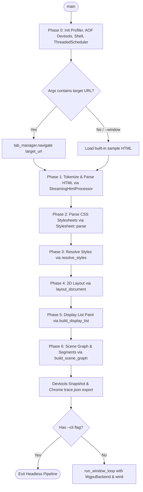

# 01 Asteria Repository Map & Structural Census

> **Document Identifier:** `AST-DOC-001`  
> **Audited Repository:** Asteria Browser Engine (`Asteria/Asteria/`)  
> **Audited Git Revision:** `3cdd5155caf544794c3d11f45dfc839665d9759b` (`main`)  
> **Working Tree State:** Pristine source files; `Cargo.lock` modified unstaged (retained).  
> **Language & Edition:** Rust (Edition 2024 target).  
> **Build System:** Cargo / `rustc` via MSVC toolchain on Windows.  

---

## 1. Executive Summary of Repository Structure

Asteria is an ambitious, from-scratch web browser rendering engine and interactive shell written in Rust. Unlike browser shells that wrap Chromium (CEF/Electron) or WebKit (Tauri/Wry), Asteria implements its own HTML tokenizer, DOM tree, CSS tokenizer/parser, specificity cascade, style resolver, block/inline/flex/grid layout engine, display list painter, data-oriented scene graph, hardware-accelerated GPU renderer using `wgpu`, multithreaded scheduler, and windowing shell using `winit`.

The repository is structured as a **single monolithic Cargo package** (`asteria 0.1.0`) providing both a library target (`src/lib.rs`) and a binary target (`src/main.rs`).

```
Asteria/Asteria/
├── Cargo.toml                  # Package manifest (12 direct dependencies)
├── Cargo.lock                  # Dependency lockfile
├── README.md                   # High-level overview and CLI run instructions
├── FLAWS.md                    # Historical audit flaws register (30 resolved, 33 cataloged)
├── FNOP.md                     # "From Now On Plan" multi-phase feature roadmap
├── report.md                   # Engine core sprint status report (Anzal & Keshav tracks)
├── commands_help.md            # Interactive CLI & shell keyboard shortcuts reference
├── trace.json                  # Sample Chrome Trace Event format export
├── docs/                       # 21 chapters of architectural and design documentation
│   ├── 00-introduction.md ... 20-known-limitations.md
├── src/                        # 30 root source modules and 3 sub-packages (77,300+ LOC)
│   ├── lib.rs                  # Library crate root (exports all 31 public modules)
│   ├── main.rs                 # CLI entry point, pipeline harness, and window launcher
│   ├── devtools/               # Observability, Chrome trace export, snapshot inspection (8 files)
│   ├── net/                    # Custom DNS resolver, TCP connection pool, TLS, HTTP/1.1 (6 files)
│   ├── renderer/               # wgpu hardware rendering backend, passes, and compositor (18 files)
│   └── [28 root modules]      # Parsers, DOM, styles, layout, paint, scene, scheduler, shell
└── tests/                      # 9 integration test suites & fixtures
    ├── comprehensive_edge_cases.rs
    ├── layout_integration.rs
    ├── paint_integration.rs
    ├── renderer_integration.rs
    ├── style_integration.rs
    ├── network_integration.rs
    ├── image_integration.rs
    ├── observability_trace.rs
    ├── snapshot_tests.rs
    └── fixtures/               # HTML/CSS test documents (gallery.html, blog.html, etc.)
```

---

## 2. Package Manifest & Dependency Census

Asteria's package manifest (`Cargo.toml:1-28`) reveals a strict minimalist dependency philosophy. Notably absent are heavy web browser dependencies such as `tokio`, `reqwest`, `hyper`, `cssparser`, `html5ever`, `taffy`, `selectors`, or `servo-*` crates.

| Dependency | Version | Declared Features | Subsystem / Responsibility | Asteria Architectural Role |
| :--- | :--- | :--- | :--- | :--- |
| `wgpu` | `22.1` | Default | GPU Hardware Acceleration | Drives vertex buffers, WGSL pipelines, swapchain rendering |
| `winit` | `0.29` | Default | Windowing & Event Loop | OS window creation, input event pump, keyboard/mouse events |
| `pollster` | `0.3` | Default | Async Blocking Harness | Blocks on async adapter/device requests in `WgpuBackend::new()` |
| `bytemuck` | `1.16` | `["derive"]` | Zero-Copy Vertex Casting | Casts vertex and index structs to GPU raw byte slices |
| `glyphon` | `0.6` | Default | GPU Text Rasterization | Font atlas management and text quads inside `TextPass` |
| `log` | `0.4` | Default | Logging Facade | Logging macros across modules |
| `env_logger` | `0.11` | Default | Logger Implementation | Terminal logging filter initialization |
| `rustls` | `0.23` | `["ring", "logging", "std", "tls12"]` | TLS Protocol Engine | HTTPS cryptographic handshake in `src/net/tls.rs` |
| `webpki-roots` | `0.26` | Default | Mozilla Root CA Store | Root certificates for TLS server validation |
| `rustls-pki-types`| `1.7` | Default | TLS PKI Types | ServerName and certificate handle types |
| `lru` | `0.12` | Default | LRU Cache Container | Pull-in dependency (largely eclipsed by custom `cache.rs`) |
| `arboard` | `3.6.1` | Default | OS Clipboard Integration | System clipboard copy/paste for text selection in `selection.rs` |

---

## 3. Module Inventory & Architectural Responsibilities

Below is the verified inventory of all 33 source modules and directories in `src/`, categorized by architectural tier:

### Tier 1: Parsing & Document Object Model (DOM)
| Module File | Size | Primary Types & Functions | Architectural Role & Callers |
| :--- | :--- | :--- | :--- |
| `src/tokens.rs` | 595 B | `Token`, `Attribute` | Token definitions for HTML tokenizer. |
| `src/tokenizer.rs`| 31.2 KB| `HtmlTokenizer`, `State` | Zero-copy HTML state machine tokenizer matching WHATWG states. |
| `src/parser.rs` | 20.9 KB| `HtmlParser`, `TreeBuilder` | Constructs DOM tree from HTML tokens; manages open element stack. |
| `src/streaming_parser.rs` | 1.7 KB | `StreamingHtmlProcessor` | Chunked HTML processor; ingests chunks and emits completed `Dom`. |
| `src/dom.rs` | 20.4 KB| `Dom`, `Node`, `NodeId`, `NodeKind`, `NodeFlags` | Flat `Vec<Node>` arena storage; zero-copy byte offsets into source. |

### Tier 2: CSS Tokenization, Parsing, and Cascade
| Module File | Size | Primary Types & Functions | Architectural Role & Callers |
| :--- | :--- | :--- | :--- |
| `src/css_tokens.rs` | 2.4 KB | `CssToken`, `CssTokenKind` | CSS token types (Ident, Delim, Hash, Dimension, Number, etc.). |
| `src/css_tokenizer.rs` | 20.5 KB| `CssTokenizer` | Character-by-character CSS tokenizer. |
| `src/css_parser.rs` | 42.8 KB| `Stylesheet`, `StyleRule`, `Selector`, `SimpleSelector`, `Declaration` | CSS parser supporting class, ID, tag, pseudo-classes, attribute operators, and `@media`. |
| `src/properties.rs` | 21.0 KB| `PropertyId`, `ALL_PROPERTIES`, `is_inherited` | Enum of 62 supported CSS properties, inheritance flags, name mappings. |
| `src/values.rs` | 121.2 KB| `ComputedStyle`, `LengthOrPercentage`, `Color`, `Display`, `BoxSizing` | Complete typed computed style representation and CSS unit parsers. |
| `src/style.rs` | 85.6 KB| `StyledNode`, `RuleIndex`, `resolve_styles`, `resolve_styles_with_viewport` | Specificity cascade, inheritance, `var()` substitution, User-Agent stylesheet. |

### Tier 3: Box Generation, Formatting Contexts, and Layout
| Module File | Size | Primary Types & Functions | Architectural Role & Callers |
| :--- | :--- | :--- | :--- |
| `src/layout.rs` | 114.1 KB| `LayoutBox`, `BoxType`, `Dimensions`, `Rect`, `EdgeSizes`, `layout_document` | 2D layout solver: Block Formatting Context (BFC), Inline Formatting Context (IFC), Flexbox row wrapping, Grid layout, Table layout, Margin collapsing, Positioned layout (relative, absolute, fixed). |

### Tier 4: Painting, Scene Graph, and Spatial Segmentation
| Module File | Size | Primary Types & Functions | Architectural Role & Callers |
| :--- | :--- | :--- | :--- |
| `src/paint.rs` | 23.7 KB| `DisplayList`, `DisplayCommand`, `build_display_list` | Generates display commands (SolidColor, RoundedRect, Border, BoxShadow, Text, Image, PushClip, PushTransform). Handles stacking contexts and z-index sorting. |
| `src/scene.rs` | 25.6 KB| `SceneGraph`, `SceneNode`, `SceneNodeId`, `SceneNodeKind`, `NodeState`, `TextRun`, `build_scene_graph` | Data-oriented SoA scene graph; decomposes display commands into contiguous spatial primitives with dirty flags and parent heuristics. |
| `src/segment.rs` | 9.4 KB | `SegmentBuilder`, `TileSegment` | 256px vertical tile spatial index for viewport culling and dirty tile tracking. |
| `src/frame.rs` | 2.6 KB | `FrameContext`, `FramePipeline` | Frame lifecycle orchestrator coordinating timing and pipeline stages. |

### Tier 5: GPU Rendering Pipeline & Presentation
| Module / Directory | Primary Types & Files | Subsystem Responsibility |
| :--- | :--- | :--- |
| `src/renderer/mod.rs` | Re-exports submodules | Gateway for renderer subsystem. |
| `src/renderer/backend/` | `WgpuBackend` | Initializes `wgpu::Instance`, `Adapter`, `Device`, `Queue`, and `Surface`. |
| `src/renderer/commands/` | `CommandBuilder`, `BatchBuilder`, `BatchVertex` | Builds vertex/index buffers for rectangles, borders, and image frame placeholders. |
| `src/renderer/graph/` | `RenderGraph`, `RenderPass` trait | Trait-based multi-pass render graph orchestrating preparation and pass execution. |
| `src/renderer/passes/` | `RectPass`, `ImagePass`, `TextPass`, WGSL shaders | Concrete passes: `RectPass` (instanced quads), `ImagePass` (textured quads), `TextPass` (Glyphon atlas). |
| `src/renderer/resources/`| `BufferPool`, `PipelineCache`, `ShaderCache`, `TextureCache` | Resource caching utilities for GPU objects. |
| `src/renderer/scheduler/`| `batching.rs`, `visibility.rs` | Pass scheduling and visibility culling helpers. |
| `src/renderer/text/` | `mod.rs` | Text subsystem stub (Glyphon abstraction layer). |
| `src/renderer/compositor.rs` | `Compositor`, `Layer` | Assembles layer tree from scene graph and renders to batch. |
| `src/renderer/window/` | `AsteriaWindow`, `run_window_loop`, `AsteriaUserEvent` | Top-level interactive event loop (`winit`), mouse/keyboard event handler, redraw loop. |

### Tier 6: Networking & Resource Loading
| Module / Directory | Primary Types & Files | Subsystem Responsibility |
| :--- | :--- | :--- |
| `src/net/mod.rs` | Re-exports networking types | Gateway for networking layer. |
| `src/net/dns.rs` | `DnsResolver`, `DnsCache` | Custom UDP/TCP DNS client querying system/configured nameservers with TTL caching. |
| `src/net/tcp.rs` | `TcpConnection`, `ConnectionPool`, `Stream` | Plain and TLS stream abstraction over `std::net::TcpStream`. |
| `src/net/tls.rs` | `TlsConnector` | Rustls TLS 1.2/1.3 client wrapper with WebPKI root certificates. |
| `src/net/http.rs` | `HttpClient`, `HttpRequest`, `HttpResponse`, `Url` | Custom HTTP/1.1 client supporting GET, POST, redirects, chunked transfer encoding, and streaming. |
| `src/net/bus.rs` | `ResourceBus`, `ResourceBusEvent` | Message bus for asynchronous streaming resource events. |
| `src/loader.rs` | `ResourceLoader`, `ResourceCache`, `PageResources`, `Resource` | High-level loader reading HTML from file or HTTP, discovering inline `<style>` and external `<link>` CSS. |

### Tier 7: Application Shell, History, and UI Chrome
| Module File | Size | Primary Types & Functions | Subsystem Responsibility |
| :--- | :--- | :--- | :--- |
| `src/shell.rs` | 15.8 KB| `TabManager`, `Tab`, `TabId`, `NavigationHistory`, `ShellEvent` | Browser shell state: multi-tab manager, per-tab back/forward history stacks, active tab selection. |
| `src/shell_ui.rs` | 34.7 KB| `ShellUiState`, `ShellHitTarget`, `render_shell_rects`, `render_shell_text` | In-engine browser chrome UI: renders tabs, omnibox, back/forward buttons, reload button, status bar. |
| `src/selection.rs` | 17.2 KB| `TextSelection`, `SelectionRange` | Mouse click-and-drag text selection across scene nodes, clipboard copying via `arboard`. |

### Tier 8: Concurrency, Scheduling, Memory, and Infrastructure
| Module File | Size | Primary Types & Functions | Subsystem Responsibility |
| :--- | :--- | :--- | :--- |
| `src/scheduler.rs` | 18.6 KB| `ThreadedScheduler`, `TaskScheduler`, `PipelineStage`, `TaskResult`, `TaskPriority` | Background worker thread pool (4 workers), channel dispatch, priority queue bucket abstraction. |
| `src/arena.rs` | 1.9 KB | `FrameArena` | Linear bump allocator utility with byte and typed allocation. |
| `src/pool.rs` | 1.2 KB | `Pool<T>` | Object pool free-list recycling generic types. |
| `src/interner.rs` | 18.4 KB| `Interner`, `Symbol`, `SYM_HTML`, `SYM_DIV`, etc. | Bidirectional string interner with pre-seeded HTML tags and CSS property names. |
| `src/cache.rs` | 3.1 KB | `LruCache<K, V>` | Custom timestamped LRU cache with FIFO/hash eviction. |
| `src/image.rs` | 8.5 KB | `ImageDecoder`, `ImageCache`, `DecodeImage`, `ImageFormat` | Image format detection (PNG, JPEG, GIF, WebP, SVG) and dimension header parser. |
| `src/animation.rs`| 8.1 KB | `AnimationManager`, `ActiveTransition`, `ActiveAnimation` | Easing curves, lerp interpolator, keyframe and transition tracker. |

### Tier 9: Observability, Diagnostics, and Devtools
| Module / Directory | Primary Types & Files | Subsystem Responsibility |
| :--- | :--- | :--- |
| `src/profiler.rs` | 10.0 KB| `EngineProfiler`, `EngineStage`, `PipelineReport` | Wall-clock timer profiling each engine pipeline stage. |
| `src/devtools/` | 8 files (19.4 KB total) | Asteria Observability Format (AOF), Chrome Trace Event JSON exporter (`trace.json`), DOM/Layout snapshotting, energy diagnostics. |

---

## 4. Entry Points & Runtime Execution Workflow

Asteria exposes two execution paths:
1. **Interactive GPU Window Mode (Default):** Launches a hardware-accelerated OS window via `winit` and `wgpu` with an interactive browser shell (tabs, address bar, scroll, text selection).
2. **Headless CLI Pipeline Mode (`--cli` flag):** Runs the full engine pipeline in headless mode, prints diagnostic ASCII trees for DOM, Style, Layout, Paint, and Scene graph, exports `trace.json`, and exits.

### Application Entry Point (`src/main.rs:16-246`)



### Interactive Window Event Loop (`src/renderer/window/window.rs:228-888`)

In interactive mode, `run_window_loop`:
1. Initializes `WgpuBackend` (creates wgpu surface, adapter, device, queue, and swapchain configuration).
2. Creates `RenderGraph` and registers `RectPass`, `ImagePass`, and `TextPass`.
3. Initializes `ShellUiState` (omnibox, tab headers, buttons).
4. Enters `event_loop.run()` listening for `winit` events:
   - `WindowEvent::Resized`: Reconfigures surface, updates viewport uniforms, triggers synchronous `build_active_scene(None)`.
   - `WindowEvent::CursorMoved`: Hit tests shell chrome first; if over webpage, maps coordinate $(x, y - \text{HEADER\_HEIGHT} + \text{scroll\_y})$ to scene graph and updates hover state / status bar link preview.
   - `WindowEvent::MouseInput`: Handles omnibox focus/navigation, tab switching/closing, new tab creation, link clicks, or text selection initiation.
   - `WindowEvent::MouseWheel`: Computes delta, clamps target scroll to `max_scroll_for_scene`, sets `needs_redraw = true`.
   - `Event::AboutToWait`: Lerps `current_scroll_y` toward `target_scroll_y` (smooth scrolling).
   - `WindowEvent::RedrawRequested`: **Rebuilds vertex and index buffers for rects and text from scratch on every redraw**, draws shell chrome rects and text over the page, executes `render_graph.render()`, and presents the swapchain texture.

---

## 5. Intended Architecture vs. Actual Architecture

A forensic comparison between Asteria's design documentation (`keshav-guide.md`, `collab-model.md`, `docs/03-project-architecture.md`) and the actual implementation reveals profound architectural divergences:

```
┌────────────────────────────────────────────────────────────────────────────────────────┐
│                        INTENDED ARCHITECTURE (Design Blueprint)                        │
├────────────────────────────────────────────────────────────────────────────────────────┤
│ Multi-crate Workspace: asteria_core, asteria_render, asteria_net, asteria_shell        │
│ Pipelined Actor Scheduler: Concurrently streaming tasks connected via bounded channels │
│ Memory Arenas: FrameArena for DOM nodes; Symbol string interning for zero-alloc styles │
│ Decoupled Retained Rendering: Scene graph uploaded once; GPU scrolls via spatial nodes  │
│ Full Platform Decoupling: Browser shell UI isolated from webpage layout                │
└────────────────────────────────────────────────────────────────────────────────────────┘
                                            │
                                            ▼ REALITY CHECK
┌────────────────────────────────────────────────────────────────────────────────────────┐
│                         ACTUAL ARCHITECTURE (Source Reality)                           │
├────────────────────────────────────────────────────────────────────────────────────────┤
│ Single Monolithic Crate: All 31 modules bundled into asteria with mutual couplings     │
│ Main-Thread Synchronous Pipeline: ThreadedScheduler dispatches dummy background jobs    │
│ Unused Arenas & Interner: FrameArena, Pool<T>, and Symbol are 100% unused in pipeline   │
│ Immediate-Mode Redraw: Every mousemove or scroll frame rebuilds vertex buffers         │
│ Monolithic Chrome Coupling: Shell UI rects & text drawn in the same pass as web page   │
└────────────────────────────────────────────────────────────────────────────────────────┘
```

### Specific Structural Discrepancies Verified:

1. **Workspace Modularity Gap:** The design specification (`keshav-guide.md:50`) mandated a multi-crate architecture: `asteria_core`, `asteria_render`, `asteria_net`, `asteria_shell`, `asteria_utils`. Instead, everything lives inside a single crate with zero crate-level compilation barriers.
2. **Disconnected Concurrency Engine:** `TaskScheduler` (`src/scheduler.rs:26-107`) provides a 5-bucket priority queue, but it is **only called in its own unit tests**. The actual runner (`ThreadedScheduler`) uses a standard FIFO `mpsc` channel. Moreover, in `main.rs:63-99`, `ThreadedScheduler::schedule()` is launched as a disconnected background task while the main thread synchronously re-executes the entire pipeline.
3. **Ghost Memory Infrastructure:** `src/arena.rs` defines `FrameArena` and `src/interner.rs` defines a 140+ constant pre-seeded `Symbol` table. **Neither is used by the DOM, parser, or style engine.** The DOM allocates individual `Vec` buffers per node, and the style cascade creates millions of short-lived `String` and `Cow<str>` allocations.
4. **Immediate-Mode Scrolling:** In `src/renderer/window/window.rs:747-794`, scrolling updates `current_scroll_y` and triggers `build_rect_batch()` and `populate_text_pass()`, regenerating all vertex arrays and atlas entries on every frame rather than updating a spatial transform matrix uniform.
5. **Dummy Image Subsystem:** Although `image.rs` and `image_pass.rs` exist, `ImagePass::set_image_quad` is never called, `ImageDecoder` fills dummy byte patterns, and `CommandBuilder` renders `` elements as flat gray rectangles with text labels.

---

## 6. Test Structure & Verification Footprint

Asteria possesses 9 integration test suites inside `tests/` comprising over 138,000 bytes of test code, alongside inline unit tests across almost every module:

| Test Suite | File Size | Scope & Invariants Tested |
| :--- | :--- | :--- |
| `tests/layout_integration.rs` | 35.9 KB | BFC width expansion, margin collapsing, flex row wrapping, grid placement, out-of-flow positioning |
| `tests/style_integration.rs` | 13.6 KB | Specificity cascade, shorthand expansion, `!important` sorting, `@media` viewport queries |
| `tests/paint_integration.rs` | 11.1 KB | Display list command generation, stacking context partition, negative/positive z-index order |
| `tests/renderer_integration.rs` | 28.3 KB | WgpuBackend initialization, render graph execution, rect batch building, buffer updates |
| `tests/comprehensive_edge_cases.rs`| 44.2 KB | Deeply nested DOMs, invalid CSS tokens, cyclic `var()` guards, flex item shrink underflows |
| `tests/network_integration.rs` | 1.6 KB | HTTP request parsing, URL relative path resolution, header formatting |
| `tests/image_integration.rs` | 2.3 KB | Image header magic byte format detection (PNG, JPEG, GIF, BMP, WebP) |
| `tests/observability_trace.rs` | 3.7 KB | Chrome Trace Event emission, AOF serialization |
| `tests/snapshot_tests.rs` | 1.1 KB | EngineSnapshot capture across DOM, Style, Layout, Scene |

---

## 7. Audit Status & Module Census Verdict

| Subsystem Tier | Module Count | Source LOC (approx) | Audit Status | Primary Concern Identified |
| :--- | :--- | :--- | :--- | :--- |
| HTML & DOM | 5 files | 4,200 | **Audited** | Zero-copy offsets prevent DOM mutation; two heap allocations per node |
| CSS & Styling | 6 files | 7,800 | **Audited** | Heavy string cloning; monolithic `ComputedStyle` with 7 heap allocations |
| Layout Engine | 1 file | 2,835 | **Audited** | Lifetimes tie `LayoutBox` to `StyledNode`; char-ratio text measurement |
| Paint & Scene | 3 files | 1,800 | **Audited** | Geometric containment heuristic for scene parent; flat display list |
| Renderer (GPU) | 18 files | 3,900 | **Audited** | Redraws regenerate vertex buffers; `ImagePass` is an uncalled stub |
| Networking | 6 files | 2,400 | **Audited** | Synchronous/blocking; URL parser ignores query/hash; no HTTP `<link>` fetch |
| Shell & UI | 3 files | 1,900 | **Audited** | Chrome rendered into page vertex buffers; single-process |
| Scheduler & Memory | 5 files | 1,600 | **Audited** | `TaskScheduler`, `FrameArena`, `Pool`, and `Symbol` are completely unused |
| Devtools & Profile | 9 files | 1,200 | **Audited** | Functional trace exporter; energy diagnostics are placeholder counters |
