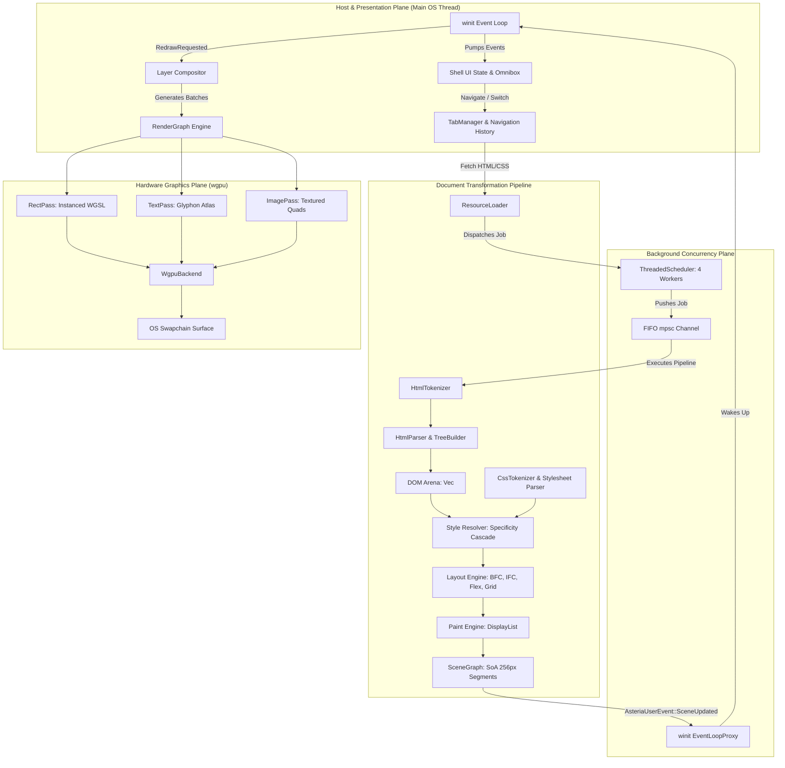
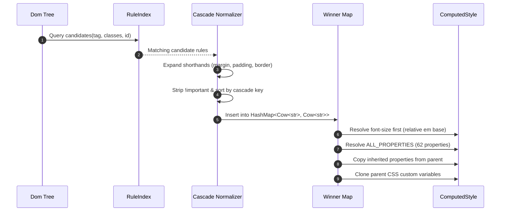
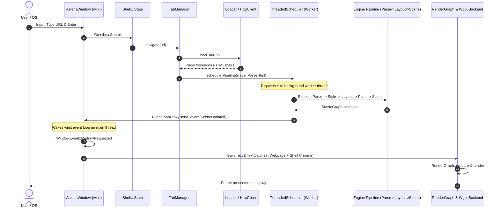

# 02 Reconstructed Asteria System Architecture

> **Document Identifier:** `AST-DOC-002`  
> **Audited Repository:** Asteria Browser Engine (`Asteria/Asteria/`)  
> **Audited Git Revision:** `3cdd5155caf544794c3d11f45dfc839665d9759b`  
> **Focus:** End-to-end runtime lifecycle, dataflows, state machines, component interactions, and architectural invariants.  

---

## 1. System Topology & Architectural Invariants

Asteria operates as a single-process, pipeline-oriented document renderer coupled to an interactive GPU-accelerated shell. The actual execution topology spans three concurrent planes:
1. **The Host / Presentation Plane:** An event-driven loop powered by `winit` (the main thread), which owns the OS window, handles mouse and keyboard input, hosts the tab manager, and dispatches frame commands to the GPU.
2. **The Background Task Plane:** A thread pool of 4 worker threads managed by `ThreadedScheduler`, communicating with the main thread via standard Rust `mpsc` channels and `winit::event_loop::EventLoopProxy`.
3. **The GPU Execution Plane:** A hardware rendering context managed by `wgpu`, executing vertex pipelines, atlas samplers, and fragment shaders against a native swapchain surface.



---

## 2. Subsystem Deep-Dive Analyses

### 2.1 DOM & Parsing Subsystem

#### Purpose & Responsibilities
The HTML parsing and DOM subsystem converts an incoming byte stream (`&[u8]`) into a tree of structured nodes representing the document hierarchy.

#### Internal Implementation
- **Tokenizer (`src/tokenizer.rs`):** Implements a zero-copy state machine (`HtmlTokenizer`) based on WHATWG specification states (`Data`, `TagOpen`, `TagName`, `BeforeAttributeName`, `AttributeName`, `AttributeValueDoubleQuoted`, etc.). Tokens (`Token::StartTag`, `Token::EndTag`, `Token::Character`, `Token::Comment`, `Token::DocType`) do not copy strings; they store `(u32, u32)` start/end byte offsets into the input slice (`src/tokens.rs:1-15`).
- **Parser (`src/parser.rs`):** Uses an open elements stack (`open_elements: Vec<NodeId>`) to build the tree. Handles self-closing tags, void elements (`img`, `br`, `hr`, `input`, `meta`, `link`), and auto-closing rules (e.g. closing `<p>` when another block tag begins).
- **Streaming Processor (`src/streaming_parser.rs`):** Wraps tokenizer and parser to support chunked byte delivery (`receive_network_chunk`).
- **DOM Arena (`src/dom.rs`):** `Dom` stores all nodes in `nodes: Vec<Node>`. Each node's identifier is its index `NodeId(u32)`.

```rust
// src/dom.rs:65-73
pub struct Node {
    pub kind: NodeKind,
    pub parent: Option<NodeId>,
    pub children: Vec<NodeId>,
    pub attributes: Vec<(u32, u32, u32, u32)>, // zero-copy byte offsets
    pub flags: NodeFlags,
}
```

#### Interfaces & Dataflow
- **Inputs:** `&[u8]` HTML byte slice.
- **Outputs:** `Dom` struct holding index-based tree.
- **Consumers:** Style resolver (`src/style.rs`), resource loader (`src/loader.rs`), devtools inspector (`src/devtools/inspector.rs`).

#### Architectural Evaluation & Failure Modes
- **Immutability Trap:** Because all tag names, attributes, and text slices reference byte offsets in the immutable initial buffer (`source: &[u8]`), **the DOM cannot be dynamically mutated**. Setting an attribute, inserting an element from JavaScript, or modifying `textContent` is structurally impossible without invalidating all `(u32, u32)` offsets across the entire tree.
- **Micro-Allocation Waste:** Every `Node` contains two independent heap allocations: `Vec<NodeId>` for `children` and `Vec<(u32, u32, u32, u32)>` for `attributes`. A page with 5,000 DOM nodes performs 10,000 tiny allocations rather than allocating child ranges inside a contiguous arena buffer.

---

### 2.2 CSS & Style Resolution Subsystem

#### Purpose & Responsibilities
Parses CSS stylesheets, sorts declarations through the cascade (origin, `!important`, specificity, source order), resolves inheritance, computes relative units (`em`, `rem`, `%`, `vh`, `vw`), performs `var()` substitutions, and produces a `StyledNode` tree carrying typed `ComputedStyle`.

#### Internal Implementation
- **CSS Tokenizer & Parser (`src/css_tokenizer.rs`, `src/css_parser.rs`):** Parses CSS rules, selectors (tag, class, id, attribute operators `~=`, `|=`, `^=`, `$=`, `*=`, pseudo-classes `:hover`, `:active`), and declarations. Supports `@media` viewport queries.
- **Rule Index (`src/style.rs:21-89`):** Pre-indexes stylesheet rules into hash buckets (`by_id`, `by_class`, `by_tag`, `universal`) using the rightmost "key selector" compound. When matching an element, only candidate rules matching its tag, classes, or ID are tested.
- **Cascade Sorter (`src/style.rs:735-741`):** Normalizes shorthands (`margin`, `padding`, `border`, `flex`, `gap`) into longhands, strips `!important`, and sorts ascending:
  $$\text{Sort Key} = (\text{important}, \text{origin}, \text{specificity}, \text{source\_order})$$
- **ComputedStyle (`src/values.rs:700-771`):** A large 45-field struct containing resolved box model values, flexbox properties, grid properties, animations, table properties, and custom variables (`HashMap<String, String>`).



#### Architectural Evaluation & Failure Modes
- **Extreme String Allocations in Hot Path:** Winner selection uses a `HashMap<Cow<str>, Cow<str>>` on every element (`style.rs:745`). For every element, 62 properties are resolved via `specified.get(prop_id.name())` doing string hashing and string comparisons.
- **Deep Cloning of Custom Variables:** Line 828 of `src/style.rs` executes:
  `computed.variables = current_variables.clone();`
  Every DOM node creates an independent clone of the entire inherited CSS custom property dictionary. A stylesheet with 50 CSS variables on 2,000 DOM nodes creates 100,000 heap-allocated strings.
- **Absence of Style Sharing:** Sibling elements with identical tags and classes (e.g. 100 `<li>` items in a list) redundantly re-run selector matching, cascade sorting, and property computation from scratch.

---

### 2.3 Layout Engine Subsystem

#### Purpose & Responsibilities
Converts the styled tree (`StyledNode`) into a 2D geometric layout tree (`LayoutBox`) with computed pixel coordinates $(x, y)$ and dimensions (content, padding, border, margin).

#### Internal Implementation
- **Formatting Contexts (`src/layout.rs`):**
  - **Block Formatting Context (BFC):** Stacks block children vertically, resolves auto margins per CSS 2.1 §10.3.3, and implements vertical margin collapsing (`collapse_margins: max(p1, p2) + min(n1, n2)`).
  - **Inline Formatting Context (IFC):** Groups inline text and inline elements into line boxes, wrapping to the next line when container boundary is reached.
  - **Flexbox Solver:** Custom row solver handling `flex-direction: row`, `flex-wrap: wrap`, `flex-grow`, `flex-shrink`, `flex-basis`, `justify-content`, `align-items`, and `gap`.
  - **Grid Solver:** Custom grid solver supporting `fr`, `px`, `%`, `repeat()`, column/row spans, and grid gap.
  - **Table Solver:** Fixed and auto table layout with row/cell distribution.
  - **Positioned Layout:** Relocates out-of-flow elements (`position: relative`, `absolute`, `fixed`) relative to their containing block.

#### Architectural Evaluation & Failure Modes
- **Lifetime Coupling:** `LayoutBox<'a>` borrows `&'a StyledNode` with lifetime `'a`. The layout tree cannot outlive the styled tree, preventing incremental re-layout, partial mutation, or background layout caching.
- **Heuristic Text Measurement:** Intrinsic text sizing does not use font metrics from a font engine. Instead, lines 2534-2558 of `src/layout.rs` implement `estimate_char_width_ratio(ch)`:
  ```rust
  fn estimate_char_width_ratio(ch: char) -> f32 {
      match ch {
          'i' | 'l' | 'j' | '!' | '.' => 0.28,
          'm' | 'w' => 0.78,
          'a'..='z' => 0.52,
          '0'..='9' => 0.58,
          'W' | 'M' => 0.88,
          'A'..='Z' => 0.65,
          _ => 0.55,
      }
  }
  ```
  This creates unavoidable desynchronization: the layout engine wraps text at boundaries computed from a character lookup table, while the GPU text pass (`glyphon`) renders actual HarfBuzz/FreeType glyph advances, causing words to clip or overflow their layout boxes.

---

### 2.4 Painting & Scene Graph Subsystem

#### Purpose & Responsibilities
Transforms the 2D `LayoutBox` hierarchy into an ordered sequence of draw commands (`DisplayList`), which is subsequently converted into a data-oriented scene graph (`SceneGraph`) partitioned into 256px spatial segments.

#### Internal Implementation
- **Paint Engine (`src/paint.rs`):** Walks the layout tree following CSS 2.1 Appendix E paint order:
  1. Stacking context root background and borders.
  2. Negative `z-index` positioned descendants (sorted ascending).
  3. In-flow descendant content (background, borders, text, image).
  4. Non-negative / auto `z-index` positioned descendants (sorted ascending).
  5. Clips (`PushClip`/`PopClip`) and 2D affine transforms (`PushTransform`/`PopTransform`).
- **Scene Graph (`src/scene.rs`):** Converts display commands into flat struct-of-arrays storage:
  - `nodes: Vec<SceneNode>` (bounding box, primitive kind, z-order, segment ID, dirty flag, interactive state, URL).
  - `colors: Vec<[f32; 4]>` (parallel normalized GPU RGBA).
  - `texts: Vec<Option<TextRun>>` (parallel text run metadata).
- **Spatial Segments (`src/segment.rs`):** Buckets scene nodes into 256px vertical strips for viewport culling and dirty tile tracking.

#### Architectural Evaluation & Failure Modes
- **Fragile Parent Containment Heuristic:** Display lists are flat linear streams. In `src/scene.rs:360-372`, parent-child relationships are reconstructed using a geometric bounding box containment heuristic:
  ```rust
  while let Some((_, top_rect)) = parent_stack.last() {
      if !rect_contains(top_rect, &node_rect) {
          parent_stack.pop();
      } else {
          break;
      }
  }
  ```
  If a parent element has transparent background, it emits no `SolidColor` command and is absent from `parent_stack`. If a child overflows its parent (e.g. negative margin or dropdown menu), `rect_contains` fails and the parent stack pops, leaving the child parentless or misparented.

---

### 2.5 GPU Rendering & Presentation Subsystem

#### Purpose & Responsibilities
Initializes `wgpu`, manages GPU buffers and pipelines, batches draw primitives, and submits command encoders to present rendered frames to the swapchain.

#### Internal Implementation
- **Render Graph (`src/renderer/graph/`):** Orchestrates three sequential passes:
  1. `RectPass` (`rect_pass.rs`): Instanced WGSL shader rendering solid rectangles and borders.
  2. `ImagePass` (`image_pass.rs`): Textured quad shader with clamp sampler.
  3. `TextPass` (`text_pass.rs`): `glyphon` text renderer managing a dynamic font atlas texture.
- **Compositor (`src/renderer/compositor.rs`):** Groups scene nodes into layers and generates vertex arrays via `BatchBuilder`.
- **Window Driver (`src/renderer/window/window.rs`):** Drives the `winit` event loop, manages cursor hover state, omnibox focus, smooth scrolling lerp, and redraws.

#### Architectural Evaluation & Failure Modes
- **Immediate-Mode Redraw Overhead:** In `window.rs:747-794`, every mouse move or scroll event rebuilds `BatchBuilder` vertex buffers from scratch. Retained spatial transformations are not utilized on the GPU; scrolling modifies node $y$ coordinates on the CPU and re-uploads entire vertex buffers.
- **Dead Image Pipeline:** `ImagePass` is registered in `RenderGraph` but `set_image_quad` is never called. `CommandBuilder:97-128` renders `` nodes as grey rectangles with text labels (`"[IMG]"`). Actual image textures are never uploaded to the GPU.
- **Chrome Coupling:** Shell UI chrome (tabs, URL bar, navigation buttons) is drawn into the exact same vertex buffers as the webpage (`window.rs:757-792`). A webpage relayout or chrome hover triggers a full composite of both.

---

### 2.6 Concurrency & Scheduling Subsystem

#### Purpose & Responsibilities
Coordinates background asynchronous work (HTML parsing, resource fetching) across worker threads to keep the main presentation thread responsive.

#### Internal Implementation
- **TaskScheduler (`src/scheduler.rs:26-107`):** An in-memory 5-priority bucket queue (`[VecDeque<Task>; 5]`) with dynamic worker count calculations.
- **ThreadedScheduler (`src/scheduler.rs:170-295`):** Spawns 4 worker threads pulling from an `mpsc::channel<WorkerJob>()`. Executes `PipelineStage` enum tasks inside `std::panic::catch_unwind` guards.

#### Architectural Evaluation & Failure Modes
- **Disconnected Priority Abstraction:** `TaskScheduler` is completely decoupled from `ThreadedScheduler`. `TaskScheduler` is only called in unit tests (`test_priority_scheduler`). `ThreadedScheduler` runs a plain FIFO queue with zero priority scheduling.
- **Monolithic Pipeline Stage:** `PipelineStage::ParseHtml` (`src/scheduler.rs:327-362`) does not merely parse HTML. When given an event loop proxy, it runs HTML parse, resource discovery, CSS fetch, CSS parse, style resolution, layout, display list generation, and scene graph creation on a single worker thread, bypassing modular pipeline stages.

---

### 2.7 Networking & Resource Loading Subsystem

#### Purpose & Responsibilities
Provides DNS resolution, TCP connection pooling, TLS negotiation, HTTP/1.1 client communication, and document subresource loading.

#### Internal Implementation
- **DNS (`src/net/dns.rs`):** Custom UDP/TCP DNS client querying upstream nameservers directly, with a 5-minute TTL cache.
- **TCP & TLS (`src/net/tcp.rs`, `src/net/tls.rs`):** Connection pool with `peek()` liveness checks; Rustls wrapper for TLS 1.2/1.3.
- **HTTP Client (`src/net/http.rs`):** Synchronous HTTP/1.1 client supporting GET, POST, redirects (up to 10), and chunked transfer encoding.
- **Resource Loader (`src/loader.rs`):** Discovers inline `<style>` and external `<link rel="stylesheet">` tags.

#### Architectural Evaluation & Failure Modes
- **Synchronous & Blocking:** All network requests (`HttpClient::get`) block the executing thread synchronously. There is no async I/O runtime (Tokio/epoll/IOCP).
- **Double HTML Parse:** `ResourceLoader::load_file` parses the HTML document into a DOM solely to find `<link>` and `<style>` tags. The pipeline caller then parses the HTML document a second time.
- **Missing Network Subresources:** `ResourceLoader::load_url` does not fetch external `<link rel="stylesheet">` files over HTTP (only inline `<style>` blocks are extracted). Image subresources are not fetched.
- **Malformed URL Handling:** `Url::parse` does not parse query strings (`?`) or hash fragments (`#`). Fragments are sent to the HTTP server in violation of RFC 9110.

---

## 3. Comprehensive Dataflow & Control Flow Map


