# 07 Phased Engineering Implementation Roadmap

> **Document Identifier:** `AST-DOC-007`  
> **Audited Repository:** Asteria Browser Engine (`Asteria/Asteria/`)  
> **Audited Git Revision:** `3cdd5155caf544794c3d11f45dfc839665d9759b`  
> **Methodology:** Dependency-aware phased execution plan based on verified findings and specifications.  

---

## 1. Classification & Prioritization Matrix

Every identified finding and specification has been evaluated across five objective criteria:

| Finding / Spec ID | Title | Severity | Priority | Complexity | Confidence | Dependency Status |
| :--- | :--- | :--- | :--- | :--- | :--- | :--- |
| **`AST-DEF-001`** (`SPEC-01`) | RFC 3986 URL parsing & CRLF injection guard | **High** | **P0** | Low | High | **Independent** |
| **`AST-DEF-002`** (`SPEC-02`) | Scene graph structural parent tracking | **High** | **P0** | Medium | High | **Blocks invalidation** |
| **`AST-DEF-004`** (`SPEC-04`) | Single-pass HTML parse in loader | **Medium** | **P0** | Low | High | **Independent** |
| **`AST-PERF-004`** | Replace O(N) `LruCache` with `lru` crate | **Medium** | **P0** | Low | High | **Independent** |
| **`AST-DEF-003`** (`SPEC-03`) | Layout intrinsic text sizing via font metrics | **High** | **P1** | Medium | High | **Blocks layout accuracy** |
| **`AST-ARC-001`** (`SPEC-05`) | Cargo workspace modularization (7 crates) | **High** | **P1** | High | High | **Prerequisite for multi-crate**|
| **`AST-PERF-001`** (`SPEC-08`) | Retained GPU scrolling via shader uniforms | **High** | **P1** | Medium | High | **Blocks 60 FPS scrolling** |
| **`AST-PERF-002`** (`SPEC-09`) | Interned symbols & Arc custom variable sharing | **High** | **P1** | Medium | High | **Blocks memory reduction** |
| **`AST-INC-001`** (`SPEC-11`) | Real image decoding & textured GPU quads | **High** | **P1** | Medium | High | **Blocks image rendering** |
| **`AST-002`** (`SPEC-10`) | Delegate Flexbox and Grid to `taffy 0.14` | **High** | **P1** | High | High | **Blocks CSS compliance** |
| **`AST-ARC-002`** (`SPEC-06`) | Unified priority queue scheduler | **Medium** | **P2** | Medium | High | **Has prerequisites** |
| **`AST-ARC-003`** (`SPEC-07`) | Decouple `LayoutBox` lifetime from `StyledNode` | **Medium** | **P2** | High | High | **Prerequisite for reflow** |
| **`AST-ARC-004`** (`SPEC-12`) | Decouple shell UI chrome from web render graph | **Medium** | **P2** | Medium | High | **Has prerequisites** |
| **`AST-INC-002`** | Hook `AnimationManager` into window event loop | **Medium** | **P2** | Low | High | **Has prerequisites** |
| **`AST-INC-003`** (`ENH-05`) | Async HTTP subresource fetcher on Tokio | **High** | **P2** | Medium | High | **Has prerequisites** |
| **`AST-SEC-002`** | Central URL scheme sanitization barrier | **Medium** | **P2** | Low | High | **Independent** |
| **`AST-ENG-001`** (`ENH-03`) | Headless GPU reftest & golden image harness | **Medium** | **P2** | Low | High | **Independent** |
| **`AST-ARC-005`** (`ENH-01`) | Mutable DOM arena & `boa_engine` JS integration | **Critical** | **P3** | High | High | **Strategic Long-Term** |
| **`ENH-02`** | Chrome DevTools Protocol (CDP) WebSocket server | **Medium** | **P3** | Medium | High | **Strategic Long-Term** |
| **`ENH-04`** | Native W3C WebGPU API exposure to web content | **Low** | **P3** | Medium | High | **Strategic Long-Term** |
| **`ENH-06`** | Public `WebView` & `EventLoopWaker` embedding API | **Medium** | **P3** | Medium | High | **Strategic Long-Term** |

---

## 2. Dependency-Aware Implementation Roadmap

```mermaid
graph TD
    subgraph S1 ["Stage 1: Essential Corrections & Zero-Risk Drops"]
        S1A["SPEC-01: RFC 3986 URL & CRLF Guard"]
        S1B["SPEC-04: Single-Pass HTML Parse"]
        S1C["SPEC-02: Structural Scene Parent Tracking"]
        S1D["Replace handwritten LruCache with lru crate"]
    end

    subgraph S2 ["Stage 2: Core Architecture & Workspace Foundation"]
        S2A["SPEC-05: 7-Crate Workspace Modularization"]
        S2B["SPEC-09: Symbol Interning & Arc Variables"]
        S2C["SPEC-08: Retained GPU Scrolling Uniforms"]
        S2D["ENH-03: Headless GPU Reftest Harness"]
    end

    subgraph S3 ["Stage 3: Standards-Compliant Layout & Graphics Engine"]
        S3A["SPEC-03: Font Glyph Advance Integration"]
        S3B["SPEC-10: Integrate Taffy 0.14 for Flex/Grid"]
        S3C["SPEC-11: Real Image Decoder & GPU ImagePass"]
        S3D["Adopt app_units::Au for Layout Math"]
    end

    subgraph S4 ["Stage 4: Asynchronous Subsystems & Shell Decoupling"]
        S4A["SPEC-06: Unified Priority Task Scheduler"]
        S4B["SPEC-07: Decouple LayoutBox Lifetimes"]
        S4C["SPEC-12: Decouple Shell UI from Web Content"]
        S4D["ENH-05: Async HTTP Subresource Fetcher"]
        S4E["Hook AnimationManager into Event Loop"]
    end

    subgraph S5 ["Stage 5: Dynamic Platform & Ecosystem Expansion"]
        S5A["AST-ARC-005: Mutable DOM & Boa JS Integration"]
        S5B["ENH-02: Chrome DevTools Protocol (CDP) Server"]
        S5C["ENH-06: Public WebView Embedding Surface"]
        S5D["ENH-04: WebGPU API Canvas Exposure"]
    end

    S1 --> S2
    S2 --> S3
    S3 --> S4
    S4 --> S5
```

---

## 3. Phased Execution Blueprints

### Stage 1: Essential Corrections & Foundational Prerequisites

- **Objective:** Eliminate confirmed functional defects, security vulnerabilities, and redundant work without modifying crate boundaries or public interfaces.
- **Included Tasks:**
  1. `SPEC-01`: Fix `Url::parse` to split query strings and strip hash fragments; add CRLF injection validation to `HttpRequest::to_bytes`.
  2. `SPEC-04`: Modify `PageResources` to carry the parsed `Dom`, eliminating the redundant second HTML parse in `main.rs` and `window.rs`.
  3. `SPEC-02`: Replace the geometric parent containment heuristic in `src/scene.rs` with explicit `BeginBox`/`EndBox` display commands.
  4. Replace handwritten `src/cache.rs` with the existing `lru = "0.12"` dependency.
- **Prerequisites:** None.
- **Source Areas Changed:** `src/net/http.rs`, `src/loader.rs`, `src/paint.rs`, `src/scene.rs`, `src/cache.rs`, `src/main.rs`.
- **Exit Criteria:**
  - `cargo test` passes cleanly.
  - Transparent parent elements correctly propagate dirty flags to children in `SceneGraph::invalidate`.
  - URLs with `#hash` and `?query` format correctly in HTTP request headers.
- **Outstanding Risks:** Minimal.

---

### Stage 2: Architecture & Workspace Foundation

- **Objective:** Establish clean compilation boundaries, eliminate memory churn, and transition rendering to retained mode.
- **Included Tasks:**
  1. `SPEC-05`: Partition repository into the 7-crate Cargo workspace (`asteria_dom`, `asteria_style`, `asteria_layout`, `asteria_paint`, `asteria_render`, `asteria_net`, `asteria_shell`).
  2. `SPEC-09`: Activate `Symbol` string handles across DOM tag names and CSS properties; wrap custom CSS properties in `Arc<HashMap<Symbol, String>>`.
  3. `SPEC-08`: Add `ViewportUniforms` to `RectPass` and `TextPass` WGSL shaders, enabling uniform-driven GPU scrolling without CPU vertex buffer regeneration.
  4. `ENH-03`: Implement offscreen headless texture capture in `asteria_render` and setup automated reftest comparisons against PNG baselines.
- **Prerequisites:** Stage 1 complete.
- **Source Areas Changed:** `Cargo.toml`, directory restructuring to `crates/`, `src/values.rs`, `src/style.rs`, `src/renderer/`.
- **Exit Criteria:**
  - All 7 workspace crates compile independently with clean dependency DAG.
  - Smooth scrolling frame times drop below 1ms on GPU queue writes.
  - Memory allocations during style resolution drop by >90%.
- **Outstanding Risks:** File moves may require updating relative paths in documentation and integration tests.

---

### Stage 3: Standards-Compliant Layout & Graphics Engine

- **Objective:** Fix visual layout drift, bring Flexbox and Grid to full W3C compliance, and activate real image rendering.
- **Included Tasks:**
  1. `SPEC-03`: Wire `glyphon::FontSystem` / font metrics into `layout_document`, replacing handwritten character ratio heuristics with true glyph advances.
  2. `SPEC-10`: Add `taffy = "0.14"` and map `ComputedStyle` to Taffy's flex/grid layout solver.
  3. Adopt `app_units::Au` integer coordinate mathematics across `asteria_layout`.
  4. `SPEC-11`: Integrate `image` crate decoding, implement `GpuTextureCache`, and connect `ImagePass` textured quad rendering.
- **Prerequisites:** Stage 2 complete.
- **Source Areas Changed:** `crates/asteria_layout/`, `crates/asteria_render/passes/image_pass.rs`, `crates/asteria_render/commands/`.
- **Exit Criteria:**
  - Running `cargo run -- tests/fixtures/gallery.html` renders real image photos with correct flexbox wrap and gap spacing.
  - Text wrapping matches actual rendered glyph bounds with zero overflow into borders.
- **Outstanding Risks:** Taffy layout coordinates must convert cleanly to `app_units::Au`.

---

### Stage 4: Asynchronous Subsystems & Shell Decoupling

- **Objective:** Move heavy operations off the main OS thread, decouple browser chrome from page rendering, and enable background network fetching.
- **Included Tasks:**
  1. `SPEC-06`: Connect `TaskScheduler` priority buckets to `ThreadedScheduler` worker threads using `Mutex` and `Condvar`.
  2. `SPEC-07`: Remove lifetime `'a` from `LayoutBox`, storing owned handles to enable cross-frame layout caching.
  3. `SPEC-12`: Isolate UI chrome (tabs, omnibox, status bar) into independent `ChromePass` vertex buffers.
  4. `ENH-05`: Implement async background subresource loader on Tokio, fetching external `<link rel="stylesheet">` and images in parallel.
  5. Hook `AnimationManager` into `Event::AboutToWait` to drive active CSS transitions and animations.
- **Prerequisites:** Stage 3 complete.
- **Source Areas Changed:** `crates/asteria_shell/`, `crates/asteria_net/`, `crates/asteria_layout/`.
- **Exit Criteria:**
  - Typing in the address bar rebuilds zero webpage vertex buffers.
  - External stylesheets referenced via `<link rel="stylesheet">` over HTTP are fetched and rendered asynchronously.
  - CSS transitions animate smoothly at 60 FPS.
- **Outstanding Risks:** Tokio async runtime integration must coordinate cleanly with synchronous `winit` event pumps.

---

### Stage 5: Dynamic Platform & Ecosystem Expansion

- **Objective:** Advance Asteria into an interactive, embeddable web platform capable of running dynamic JavaScript applications.
- **Included Tasks:**
  1. `AST-ARC-005` & `ENH-01`: Refactor DOM nodes to support dynamic mutation; embed pure-Rust `boa_engine` behind an isolated script thread actor.
  2. `ENH-02`: Spin up a local WebSocket server implementing Chrome DevTools Protocol (CDP) for live inspection via `chrome://inspect`.
  3. `ENH-06`: Formalize `asteria_traits` and provide a public `WebView` embedding API for third-party Rust applications.
  4. `ENH-04`: Bind Asteria's existing `wgpu::Device` to web content via `navigator.gpu` bindings.
- **Prerequisites:** Stage 4 complete.
- **Source Areas Changed:** `crates/asteria_dom/`, `crates/asteria_shell/`, new `crates/asteria_traits/`, `crates/asteria_js/`.
- **Exit Criteria:**
  - Interactive HTML fixtures with `<button onclick="...">` execute JavaScript and dynamically re-render DOM changes.
  - Chrome DevTools connects to Asteria over WebSockets and displays live DOM and computed styles.
  - Third-party Rust example (`examples/embedded_view.rs`) embeds Asteria in an external window.
