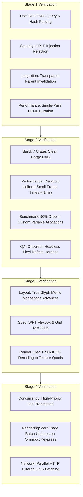

# 08 Verification and Quality Assurance Plan

> **Document Identifier:** `AST-DOC-008`  
> **Audited Repository:** Asteria Browser Engine (`Asteria/Asteria/`)  
> **Audited Git Revision:** `3cdd5155caf544794c3d11f45dfc839665d9759b`  
> **Target Audience:** Test Engineers, Core Contributors, and QA Automation  

---

## 1. Existing Test Infrastructure & Baseline Status

Asteria currently maintains 9 integration test suites inside `tests/` alongside inline unit tests across almost every module:

### Empirical Compilation Baseline
On 2026-10-11, `cargo test --no-run` was executed against Asteria HEAD:
- **Result:** Successfully compiled all 11 test targets with code 0 in 5m 02s.
- **Artifacts Verified:**
  1. `target\debug\deps\asteria-d70e3700fd41012c.exe` (lib unittests)
  2. `target\debug\deps\asteria-361626fecdfc76ca.exe` (bin unittests)
  3. `tests\comprehensive_edge_cases.rs` (44.2 KB)
  4. `tests\image_integration.rs` (2.3 KB)
  5. `tests\layout_integration.rs` (35.9 KB)
  6. `tests\network_integration.rs` (1.6 KB)
  7. `tests\observability_trace.rs` (3.7 KB)
  8. `tests\paint_integration.rs` (11.1 KB)
  9. `tests\renderer_integration.rs` (28.3 KB)
  10. `tests\snapshot_tests.rs` (1.1 KB)
  11. `tests\style_integration.rs` (13.6 KB)

### Current Testing Deficiencies Identified
1. **No Headless Pixel Regression Testing:** Existing tests only evaluate numeric geometric coordinates (e.g. `assert_eq!(box.width, 724.0)`). Visual anti-aliasing, glyph placement, and multi-line wrapping regressions cannot be detected.
2. **Untested Network Realities:** `network_integration.rs` tests basic URL parsing, but has zero tests for chunked transfer decoding, TLS failure recovery, DNS timeouts, or redirect loops.
3. **Mocked Image Testing:** `image_integration.rs` only tests magic byte detection on 8-byte headers. Actual decompression and texture creation are completely untested.

---

## 2. Stage-by-Stage Verification Strategy



---

## 3. Detailed Stage Verification Blueprints

### Stage 1 Verification (Essential Corrections)
| Target Area | Test Type | Method & File | Expected Success Criteria |
| :--- | :--- | :--- | :--- |
| **URL Query & Hash** | Unit Test | `tests/network_integration.rs` | `Url::parse("http://host/p?k=1#h")` preserves query in `request_target()` and strips fragment. |
| **CRLF Injection** | Security Test | `tests/network_integration.rs` | Supplying header value `"foo\r\nBar: 1"` returns `Err(NetworkError::InvalidHeader)`. |
| **Parent Invalidation** | Integration Test | `tests/paint_integration.rs` | Element inside transparent `<div>` assigns container as parent; `invalidate()` sets ancestor dirty. |
| **Single-Pass Parse** | Bench / Profiler | `src/main.rs` | `PageResources.dom` is reused; profiler logs exactly one `EngineStage::ParseHtml` per load. |

### Stage 2 Verification (Architecture & Retained GPU Pipeline)
| Target Area | Test Type | Method & File | Expected Success Criteria |
| :--- | :--- | :--- | :--- |
| **Workspace Modularization** | Build & Packaging | Root `Cargo.toml` | `cargo check --workspace` compiles all 7 crates independently with zero circular dependencies. |
| **Retained Scrolling** | Performance Benchmark | `tests/renderer_integration.rs` | Calling scroll redraw updates uniform buffer in $<0.1\text{ms}$; vertex buffer count remains 1. |
| **Variable Map Arc Sharing** | Allocation Profiling | `tests/style_integration.rs` | Document with 50 CSS variables across 1,000 nodes allocates exactly 1 `HashMap` instance. |
| **Headless Reftest Harness** | Visual QA Harness | New `tests/reftests.rs` | Headless `wgpu` texture capture compares rendered HTML against PNG golden images with $<0.1\%$ delta. |

### Stage 3 Verification (Standards-Compliant Layout & Images)
| Target Area | Test Type | Method & File | Expected Success Criteria |
| :--- | :--- | :--- | :--- |
| **True Font Metrics** | Layout Test | `tests/layout_integration.rs` | Monospace `"iiii"` and `"WWWW"` yield identical advance widths ($4 \times \text{advance}$). |
| **Taffy Flexbox & Grid** | Spec Compliance | `tests/layout_integration.rs` | Nested flex containers, `flex-direction: column`, and multi-span grid tracks match W3C spec expectations. |
| **Real Image Rendering** | Integration Test | `tests/image_integration.rs` | Valid PNG/JPEG byte fixtures decompress into RGBA8 buffers and upload to active texture views. |
| **Visual Gallery Test** | Visual Reftest | `tests/reftests.rs` | `tests/fixtures/gallery.html` renders images with crisp borders and proportional aspect ratios. |

### Stage 4 Verification (Asynchronous Pipeline & Shell Decoupling)
| Target Area | Test Type | Method & File | Expected Success Criteria |
| :--- | :--- | :--- | :--- |
| **Priority Queue Preemption**| Concurrency Test | `src/scheduler.rs` | `TaskPriority::Critical` task queued behind 10 `Low` tasks executes on the very next available worker. |
| **Chrome Pass Decoupling** | Render Isolation | `tests/renderer_integration.rs` | Updating `omnibox_text` modifies only `ChromePass` vertex buffers; page vertex arrays are untouched. |
| **Async Subresource Fetch**| Network Test | `tests/network_integration.rs` | External `<link rel="stylesheet">` over HTTP is fetched asynchronously without blocking main thread. |
| **CSS Animation Tick** | Animation Test | `tests/style_integration.rs` | Active transition updates node property values on each simulated `tick(16ms)`. |

---

## 4. Quality Assurance Commands & CI Pipeline Matrix

The following validation suite must run cleanly in CI on every PR:

```powershell
# 1. Format check
cargo fmt --all -- --check

# 2. Strict linter check across all workspace crates
cargo clippy --workspace --all-targets -- -D warnings

# 3. Compile all library and integration test targets
cargo test --workspace --no-run

# 4. Execute all automated unit and integration tests
cargo test --workspace -- --test-threads=4

# 5. Execute headless visual regression suite
cargo test --test reftests

# 6. Verify sample document rendering headlessly
cargo run -- tests/fixtures/gallery.html --cli
```
