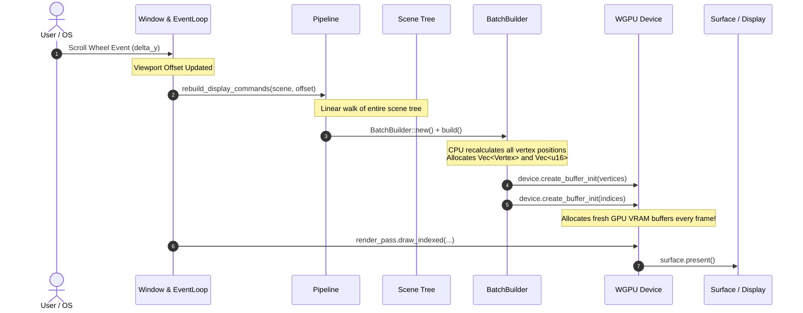
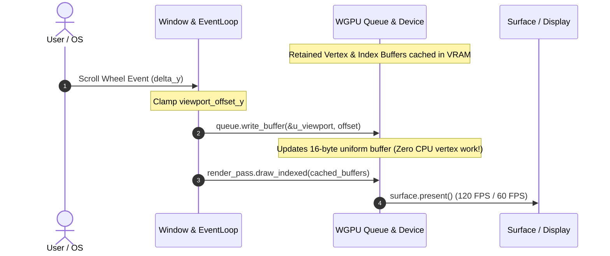

# ASTERIA ARCHITECTURAL DIAGRAMS: SYSTEM DATAFLOW

## 1. Current Asteria Frame Pipeline (Immediate-Mode Thrashing)

The diagram below illustrates the current data flow from user scroll events to GPU presentation, highlighting the bottleneck at the BatchBuilder stage (`AST-DEF-001`, `AST-PERF-001`).

---

## 2. Remediated Frame Pipeline (Retained GPU Uniform Offsets)

The diagram below illustrates the optimized flow specified in `SPEC-08` and `SPEC-01`, eliminating CPU rebuilding during scrolling and achieving 120 FPS performance.

