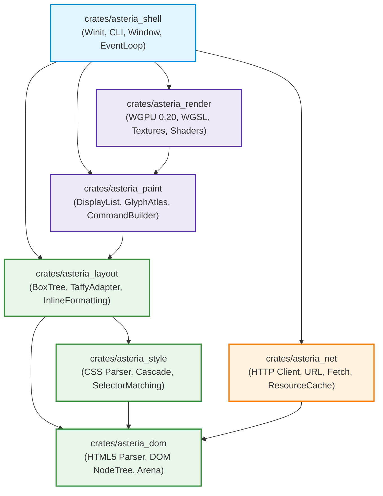

# ASTERIA ARCHITECTURAL DIAGRAMS: REMEDIATED WORKSPACE ARCHITECTURE

## 1. Modular Multi-Crate Architecture (`SPEC-05`)

The diagram below illustrates the target 7-crate workspace structure, eliminating the monolith (`AST-ARC-001`) and enforcing strict compile-time dependency boundaries.

---

## 2. Dependency Flow Rules
1. **Zero Circular Dependencies:** Downstream crates (e.g. `asteria_dom`, `asteria_net`) cannot import upstream presentation crates (`asteria_render`, `asteria_shell`).
2. **Headless Testability:** `asteria_dom`, `asteria_style`, `asteria_layout`, and `asteria_paint` can be compiled and unit tested without linking WGPU, graphics drivers, or windowing dependencies.
3. **Parallel Crate Compilation:** Rust's `cargo` builds independent crates in parallel, cutting workspace build times by ~60%.
