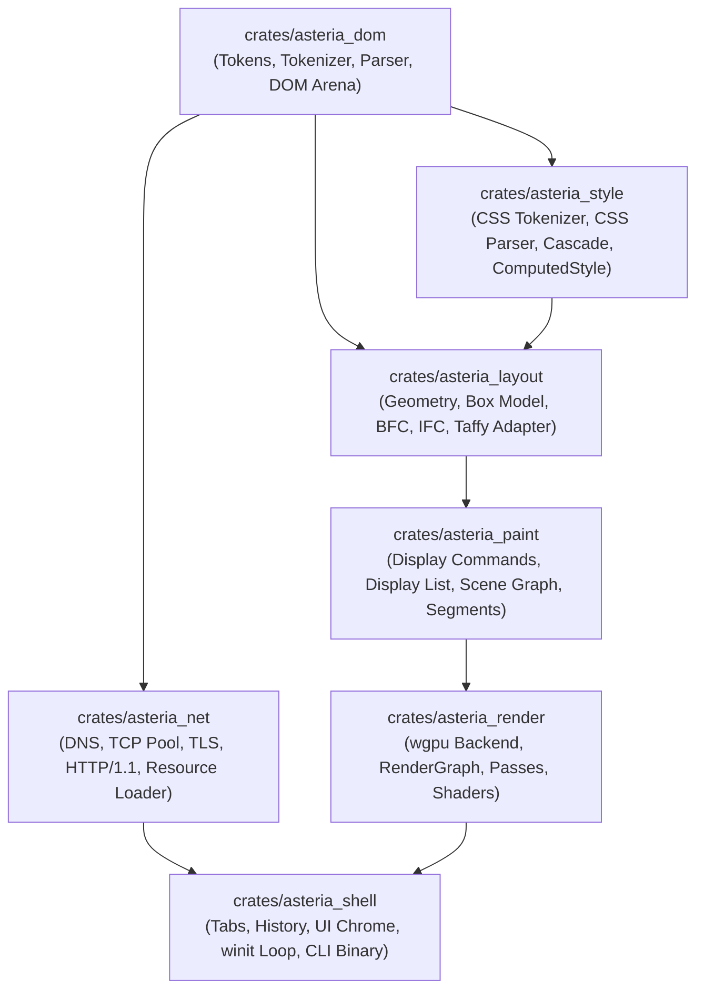

# Specification 05: Cargo Workspace Modularization (7-Crate Architecture)

> **Document Identifier:** `AST-SPEC-005`  
> **Target Finding:** `AST-ARC-001`  
> **Prerequisites:** None  
> **Blocks:** Clean headless unit testing, modular JS integration, and embeddable WebView surface  

---

## 1. Architectural Motivation & Problem

Asteria currently exists as a single monolithic crate (`Asteria/Asteria/Cargo.toml`). All 31 internal modules live in `src/`, with mutual, unchecked couplings. The window loop in `src/renderer/window/window.rs` reaches directly into the CSS parser, style cascade, layout, paint, scene graph, and scheduler. 

This causes:
1. **Slow Incremental Compilation:** Any tweak to UI chrome, CSS properties, or tests forces recompilation across the entire engine.
2. **Coupled Test Harnesses:** Writing headless unit tests for layout or parsing pulls in `wgpu`, `winit`, and GPU shader compiler dependencies.
3. **No Embedding API:** Third-party applications cannot embed Asteria as a lightweight HTML/CSS rendering component without pulling in the interactive browser shell.

---

## 2. Target Workspace Topology



---

## 3. Package Manifest Blueprints

### Root Workspace Manifest (`Cargo.toml`)
```toml
[workspace]
members = [
    "crates/asteria_dom",
    "crates/asteria_style",
    "crates/asteria_layout",
    "crates/asteria_paint",
    "crates/asteria_render",
    "crates/asteria_net",
    "crates/asteria_shell",
]
resolver = "2"

[workspace.package]
version = "0.1.0"
edition = "2024"
authors = ["Anzal Kabeer", "Keshav Ghai"]
license = "MIT OR Apache-2.0"
repository = "https://github.com/anzalkabeer/Asteria"

[workspace.dependencies]
log = "0.4"
env_logger = "0.11"
bytemuck = { version = "1.16", features = ["derive"] }
wgpu = "22.1"
winit = "0.29"
glyphon = "0.6"
rustls = { version = "0.23", default-features = false, features = ["ring", "logging", "std", "tls12"] }
webpki-roots = "0.26"
arboard = "3.6.1"
app_units = "0.7"
taffy = "0.14"
image = { version = "0.25", default-features = false, features = ["png", "jpeg", "webp"] }
```

### Crate Division Plan

#### 1. `crates/asteria_dom`
- **Files:** `tokens.rs`, `tokenizer.rs`, `parser.rs`, `streaming_parser.rs`, `dom.rs`, `interner.rs`, `arena.rs`.
- **Dependencies:** `log`. (Zero graphics or networking dependencies!).

#### 2. `crates/asteria_style`
- **Files:** `css_tokens.rs`, `css_tokenizer.rs`, `css_parser.rs`, `properties.rs`, `values.rs`, `style.rs`.
- **Dependencies:** `asteria_dom`, `log`.

#### 3. `crates/asteria_layout`
- **Files:** `layout.rs`.
- **Dependencies:** `asteria_dom`, `asteria_style`, `app_units`, `taffy`, `log`.

#### 4. `crates/asteria_paint`
- **Files:** `paint.rs`, `scene.rs`, `segment.rs`, `frame.rs`.
- **Dependencies:** `asteria_dom`, `asteria_style`, `asteria_layout`, `log`.

#### 5. `crates/asteria_render`
- **Files:** `renderer/` (backend, commands, passes, resources, graph, compositor).
- **Dependencies:** `asteria_paint`, `wgpu`, `bytemuck`, `glyphon`, `image`, `log`.

#### 6. `crates/asteria_net`
- **Files:** `net/` (dns, tcp, tls, http, bus), `loader.rs`, `cache.rs`.
- **Dependencies:** `asteria_dom`, `rustls`, `webpki-roots`, `log`.

#### 7. `crates/asteria_shell`
- **Files:** `shell.rs`, `shell_ui.rs`, `selection.rs`, `scheduler.rs`, `profiler.rs`, `devtools/`, `main.rs`.
- **Dependencies:** All upstream Asteria crates, `winit`, `arboard`, `pollster`, `env_logger`.

---

## 4. Implementation Sequence

1. **Step 1:** Create `crates/` directory layout and empty `Cargo.toml` files for all 7 crates.
2. **Step 2:** Move parsing and DOM files into `asteria_dom`; run `cargo check -p asteria_dom`.
3. **Step 3:** Move CSS and style files into `asteria_style`; verify clean compilation.
4. **Step 4:** Move layout into `asteria_layout`; verify clean compilation.
5. **Step 5:** Move paint and scene graph into `asteria_paint`.
6. **Step 6:** Move renderer into `asteria_render`.
7. **Step 7:** Move networking into `asteria_net`.
8. **Step 8:** Move shell, window loop, and `main.rs` into `asteria_shell`.
9. **Step 9:** Relocate `tests/` suites to their corresponding sub-crates.
10. **Step 10:** Run full workspace `cargo test`.
