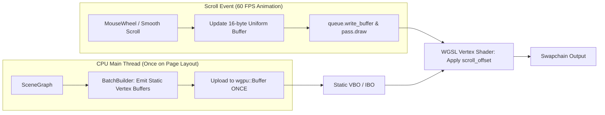

# Specification 08: Retained-Mode GPU Viewport Scrolling & Uniform Transforms

> **Document Identifier:** `AST-SPEC-008`  
> **Target Finding:** `AST-PERF-001`  
> **Prerequisites:** None  
> **Blocks:** 60+ FPS smooth scrolling and power-efficient presentation  

---

## 1. Architectural Problem Statement

In `src/renderer/window/window.rs:747-794`, every mouse wheel scroll step or smooth scrolling tick triggers `WindowEvent::RedrawRequested`. During redraw:
1. `build_rect_batch()` walks all scene nodes on the CPU.
2. For every scene node, it calculates `node.rect.y + HEADER_HEIGHT - scroll_y`.
3. It pushes tens of thousands of floats into a new `BatchBuilder`.
4. `rp.update_buffers()` allocates new GPU vertex buffers and uploads the data over PCIe.
5. `populate_text_pass()` clears and repopulates all text glyph runs.

This represents **immediate-mode CPU-bound rendering**. The CPU recalculates what the GPU should be doing via a simple matrix or offset uniform.

---

## 2. Retained GPU Scrolling Architecture



---

## 3. Concrete WGSL Shader & Uniform Specification

### Uniform Buffer Layout
```rust
#[repr(C)]
#[derive(Copy, Clone, Debug, bytemuck::Pod, bytemuck::Zeroable)]
pub struct ViewportUniforms {
    pub scroll_offset: [f32; 2],
    pub viewport_size: [f32; 2],
}
```

### WGSL Vertex Shader Update (`src/renderer/passes/shader.wgsl`)
```wgsl
struct ViewportUniforms {
    scroll_offset: vec2<f32>,
    viewport_size: vec2<f32>,
};

@group(0) @binding(0)
var<uniform> uniforms: ViewportUniforms;

struct VertexInput {
    @location(0) position: vec2<f32>,
    @location(1) color: vec4<f32>,
};

struct VertexOutput {
    @builtin(position) clip_position: vec4<f32>,
    @location(0) color: vec4<f32>,
};

@vertex
fn vs_main(in: VertexInput) -> VertexOutput {
    var out: VertexOutput;
    
    // Apply GPU scroll offset directly to vertex position
    let world_pos = in.position - uniforms.scroll_offset;
    
    // Convert to Normalized Device Coordinates [-1.0, 1.0]
    let ndc_x = (world_pos.x / (uniforms.viewport_size.x * 0.5)) - 1.0;
    let ndc_y = 1.0 - (world_pos.y / (uniforms.viewport_size.y * 0.5));
    
    out.clip_position = vec4<f32>(ndc_x, ndc_y, 0.0, 1.0);
    out.color = in.color;
    return out;
}
```

---

## 4. Implementation Steps in `src/renderer/`

1. **Step 1:** In `RectPass::new`, create a uniform buffer `wgpu::Buffer` with usage `UNIFORM | COPY_DST`, and add a bind group entry at binding 0.
2. **Step 2:** Update `shader.wgsl` to accept `ViewportUniforms` and perform the NDC transformation using `uniforms.scroll_offset`.
3. **Step 3:** In `AsteriaWindow`, retain the `BatchBuilder` and vertex/index buffers. Only rebuild them when `AsteriaUserEvent::SceneUpdated` arrives or the window is resized.
4. **Step 4:** In `WindowEvent::MouseWheel` and `Event::AboutToWait`, call `queue.write_buffer(&uniform_buffer, 0, bytemuck::bytes_of(&uniforms))`.
5. **Step 5:** Profile scrolling with `AofInspector`; verify that frame times drop below 1ms.
