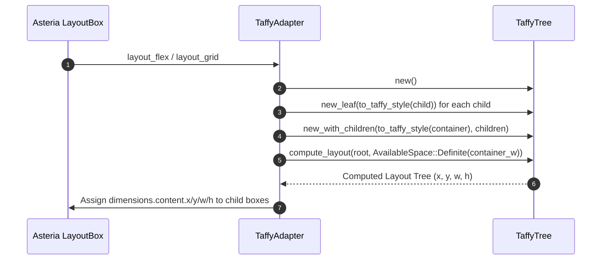

# Specification 10: Delegation of CSS Flexbox and Grid Sizing to Taffy 0.14

> **Document Identifier:** `AST-SPEC-010`  
> **Target Finding:** `AST-002`  
> **Prerequisites:** Clean `ComputedStyle` sizing properties  
> **Blocks:** Full CSS Flexbox and Grid Level 1 standards compliance  

---

## 1. Problem Statement & Motivation

Asteria's layout engine (`src/layout.rs`) contains ~400 lines of handwritten flex row layout and ~250 lines of grid calculations.
- It only supports `flex-direction: row` with rudimentary wrapping.
- It does not support `flex-direction: column`, `column-reverse`, `row-reverse`, flex grow normalization, or baseline alignment.
- Grid layout does not handle minmax tracks, auto-fit, auto-fill, or complex track spanning.

Servo solved this exact challenge by integrating `taffy 0.14` (`components/layout/taffy/`). Taffy is a pure Rust, high-performance, specification-compliant Flexbox and Grid layout solver maintained by the Dioxus and Bevy communities.

---

## 2. Style Mapping Specification

### Converting `ComputedStyle` to `taffy::style::Style`
```rust
use taffy::style::{Style, Display as TDisplay, FlexDirection as TFlexDir, FlexWrap as TFlexWrap};
use taffy::style::{AlignItems as TAlignItems, JustifyContent as TJustifyContent};
use taffy::style_helpers::{length, percent, auto};
use crate::values::{ComputedStyle, Display, FlexDirection, FlexWrap, AlignItems, JustifyContent};

pub fn to_taffy_style(s: &ComputedStyle) -> Style {
    Style {
        display: match s.display {
            Display::Flex => TDisplay::Flex,
            Display::Grid => TDisplay::Grid,
            Display::None => TDisplay::None,
            _ => TDisplay::Block,
        },
        flex_direction: match s.flex_direction {
            FlexDirection::Row => TFlexDir::Row,
            FlexDirection::RowReverse => TFlexDir::RowReverse,
            FlexDirection::Column => TFlexDir::Column,
            FlexDirection::ColumnReverse => TFlexDir::ColumnReverse,
        },
        flex_wrap: match s.flex_wrap {
            FlexWrap::NoWrap => TFlexWrap::NoWrap,
            FlexWrap::Wrap => TFlexWrap::Wrap,
            FlexWrap::WrapReverse => TFlexWrap::WrapReverse,
        },
        align_items: match s.align_items {
            AlignItems::FlexStart => Some(TAlignItems::FlexStart),
            AlignItems::FlexEnd => Some(TAlignItems::FlexEnd),
            AlignItems::Center => Some(TAlignItems::Center),
            AlignItems::Baseline => Some(TAlignItems::Baseline),
            AlignItems::Stretch => Some(TAlignItems::Stretch),
        },
        justify_content: match s.justify_content {
            JustifyContent::FlexStart => Some(TJustifyContent::FlexStart),
            JustifyContent::FlexEnd => Some(TJustifyContent::FlexEnd),
            JustifyContent::Center => Some(TJustifyContent::Center),
            JustifyContent::SpaceBetween => Some(TJustifyContent::SpaceBetween),
            JustifyContent::SpaceAround => Some(TJustifyContent::SpaceAround),
            JustifyContent::SpaceEvenly => Some(TJustifyContent::SpaceEvenly),
        },
        flex_grow: s.flex_grow,
        flex_shrink: s.flex_shrink,
        gap: taffy::geometry::Size {
            width: length(s.grid_gap.left),
            height: length(s.grid_gap.top),
        },
        ..Default::default()
    }
}
```

---

## 3. Layout Integration Architecture



---

## 4. Implementation Steps

1. **Step 1:** Add `taffy = "0.14"` to `Cargo.toml`.
2. **Step 2:** Add `to_taffy_style` helper in `src/layout.rs`.
3. **Step 3:** In `LayoutBox::layout_flex`, build a `TaffyTree`, dispatch layout solving, and read back computed rectangles.
4. **Step 4:** In `LayoutBox::layout_grid`, wire grid track styles and read back computed cells.
5. **Step 5:** Delete legacy handwritten flex row math (`layout_flex_row`).
6. **Step 6:** Run `cargo test` and verify that `tests/fixtures/gallery.html` renders with correct wrapping and gaps.
