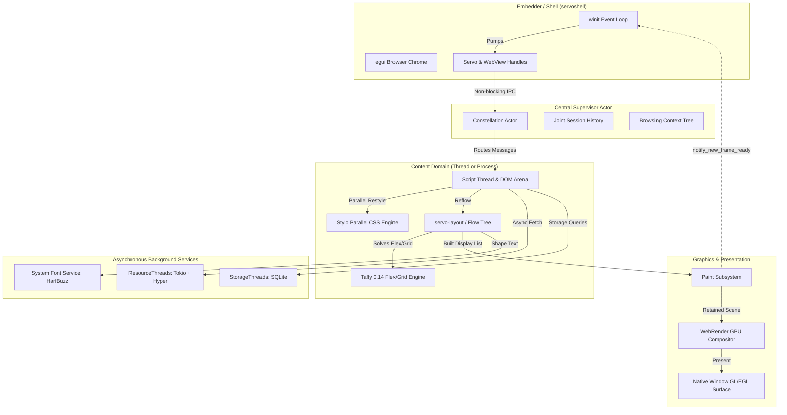

# 00 Executive Summary: Forensic Architectural Audit of Servo for Asteria

> **Audit Identifier:** `ASTERIA_SERVO_AUDIT_2026_10`  
> **Audited Repository:** Servo (`servo/`)  
> **Audited Git Revision:** `7ca9f80268a1d76e698560db82463e7960aa7845` (Branch `main`, clean tree)  
> **Beneficiary Project:** Asteria Browser Engine (`Asteria/Asteria/`, Git Commit `3cdd5155caf544794c3d11f45dfc839665d9759b`)  
> **Audit Deliverable Root:** `z:\1mportant stuff\Codes written by me (New)\asteria_servo_audit\`

---

## 1. Executive Purpose & Investigation Scope

This audit was conducted as an exhaustive, forensic architectural investigation of the Servo browser engine to establish an evidence-backed engineering reference for the design, stabilization, and advancement of Asteria.

Asteria is an ambitious from-scratch web browser engine written in Rust using `wgpu` for hardware acceleration. As documented in Asteria's `FLAWS.md` and codebase, Asteria has achieved impressive early milestones (HTML/CSS parsing, block/inline layout, basic flexbox rows, tabbed shell, and wgpu painting) but faces typical architectural friction points:
1. Containing block and percentage resolution bugs (`FLAWS.md:1.1, 1.6`).
2. Inline line wrapping double-layout and anonymous block gaps (`FLAWS.md:1.5, 1.7`).
3. Handwritten flexbox constraint instability (`FLAWS.md:2.4`).
4. Monolithic single-crate coupling between browser UI chrome, windowing, and page layout.
5. Immediate-mode vertex buffer regeneration on every frame during scrolling.

Servo was investigated as a mature, production-grade reference engine to answer: **How did Servo solve these exact problems, which of its abstractions are directly reusable or adaptable, and what architectural traps should Asteria avoid?**

---

## 2. Synthesis of Servo's Core Architecture

### Key Architectural Invariants Established:
1. **Strict Core/Traits Boundary:** Concrete subsystems do not depend directly on other concrete subsystems. Servo splits every component into an implementation crate (`components/<name>`) and a trait abstraction crate (`components/shared/<name>`), completely eliminating circular dependencies.
2. **Actor-Based Deadlock Prevention:** Thread communication follows an acyclic "Can-Block-On" DAG hierarchy (`constellation.rs:63–86`). Constellation can block on Paint/Embedder, Script can block on I/O, but nothing ever blocks synchronously on Script.
3. **Decoupled Retained Rendering:** Layout does not issue immediate draw calls. It emits an immutable `DisplayList` uploaded to WebRender. GPU-accelerated scrolling and CSS transforms update spatial node uniforms on the compositor without re-laying out boxes or rebuilding vertex arrays.
4. **Delegation of Spec-Heavy Subsystems:** Servo delegates multidimensional Flexbox and Grid calculations to `taffy 0.14`, text shaping to `harfbuzz-sys`, and CSS cascade evaluation to `stylo`.

---

## 3. Master Deliverable Navigation

This audit has generated 11 standalone, persistent engineering references in `asteria_servo_audit/`:

| Document | Primary Contents & Focus |
| :--- | :--- |
| [`01_REPOSITORY_MAP.md`](file:///z:/1mportant%20stuff/Codes%20written%20by%20me%20(New)/asteria_servo_audit/01_REPOSITORY_MAP.md) | Top-level repository directory map, Cargo workspace configuration, build system, entry points, and platform matrix. |
| [`02_CRATE_CATALOG.md`](file:///z:/1mportant%20stuff/Codes%20written%20by%20me%20(New)/asteria_servo_audit/02_CRATE_CATALOG.md) | Complete census of all 77 workspace packages categorized across 11 functional tiers with manifests, APIs, and Asteria relevance. |
| [`03_SYSTEM_ARCHITECTURE.md`](file:///z:/1mportant%20stuff/Codes%20written%20by%20me%20(New)/asteria_servo_audit/03_SYSTEM_ARCHITECTURE.md) | High-level system architecture, actor model, thread topology, deadlock prevention DAG, and Asteria structural comparison. |
| [`04_RUNTIME_FLOWS.md`](file:///z:/1mportant%20stuff/Codes%20written%20by%20me%20(New)/asteria_servo_audit/04_RUNTIME_FLOWS.md) | Traces 7 end-to-end runtime flows with sequence diagrams (Startup, WebView embedding, Navigation, DOM/JS, Layout/Paint, Input, Teardown). |
| [`05_APIS_AND_EXTENSION_POINTS.md`](file:///z:/1mportant%20stuff/Codes%20written%20by%20me%20(New)/asteria_servo_audit/05_APIS_AND_EXTENSION_POINTS.md) | Public embedding surface, `ServoBuilder`, `WebView`, `EventLoopWaker`, `RenderingContext`, and reusability matrix. |
| [`06_ASTERIA_INTEGRATION_GUIDE.md`](file:///z:/1mportant%20stuff/Codes%20written%20by%20me%20(New)/asteria_servo_audit/06_ASTERIA_INTEGRATION_GUIDE.md) | Practical, prioritized roadmap for Asteria (14 actionable findings: `AST-001` through `AST-014`). |
| [`07_SECURITY_RELIABILITY_PERFORMANCE.md`](file:///z:/1mportant%20stuff/Codes%20written%20by%20me%20(New)/asteria_servo_audit/07_SECURITY_RELIABILITY_PERFORMANCE.md) | Process boundaries, Gaol sandboxing, memory safety audit, background hang monitor, and `MallocSizeOf` memory tracking. |
| [`08_TESTING_BUILD_AND_DEBUG_GUIDE.md`](file:///z:/1mportant%20stuff/Codes%20written%20by%20me%20(New)/asteria_servo_audit/08_TESTING_BUILD_AND_DEBUG_GUIDE.md) | Mach build driver, WPT testing harness, targeted unit test commands, Perfetto profiling, and visual reftests. |
| [`09_SOURCE_EVIDENCE_INDEX.md`](file:///z:/1mportant%20stuff/Codes%20written%20by%20me%20(New)/asteria_servo_audit/09_SOURCE_EVIDENCE_INDEX.md) | Master searchable evidence index mapping stable finding IDs (`ARCH-`, `FLOW-`, `API-`, `AST-`, `SEC-`, `PERF-`, `TEST-`) to line numbers. |
| [`10_AUDIT_COVERAGE_AND_REMAINING_WORK.md`](file:///z:/1mportant%20stuff/Codes%20written%20by%20me%20(New)/asteria_servo_audit/10_AUDIT_COVERAGE_AND_REMAINING_WORK.md) | Audit coverage matrix, empirical verification check, and explicit inventory of remaining work. |
| [`PROGRESS.md`](file:///z:/1mportant%20stuff/Codes%20written%20by%20me%20(New)/asteria_servo_audit/PROGRESS.md) | Persistent progress checkpoint tracking completed phases and verified environmental invariants. |

### Deep-Dive Subsystem Reports in `subsystems/`:
1. [`subsystems/01_EMBEDDING_AND_SHELL.md`](file:///z:/1mportant%20stuff/Codes%20written%20by%20me%20(New)/asteria_servo_audit/subsystems/01_EMBEDDING_AND_SHELL.md): `ServoBuilder`, `WebView`, `EventLoopWaker`, `servoshell`.
2. [`subsystems/02_CONSTELLATION_AND_LIFECYCLE.md`](file:///z:/1mportant%20stuff/Codes%20written%20by%20me%20(New)/asteria_servo_audit/subsystems/02_CONSTELLATION_AND_LIFECYCLE.md): Frame forest, pipeline lifecycles, and `JointSessionHistory`.
3. [`subsystems/03_SCRIPT_AND_DOM.md`](file:///z:/1mportant%20stuff/Codes%20written%20by%20me%20(New)/asteria_servo_audit/subsystems/03_SCRIPT_AND_DOM.md): DOM arena, `MutNullableDom` pointers, WebIDL codegen, and SpiderMonkey GC reflection.
4. [`subsystems/04_NETWORKING_AND_RESOURCE_LOADING.md`](file:///z:/1mportant%20stuff/Codes%20written%20by%20me%20(New)/asteria_servo_audit/subsystems/04_NETWORKING_AND_RESOURCE_LOADING.md): WHATWG Fetch algorithm, streaming bodies, cookie jar, and CORS cache.
5. [`subsystems/05_STYLING_AND_SELECTOR_MATCHING.md`](file:///z:/1mportant%20stuff/Codes%20written%20by%20me%20(New)/asteria_servo_audit/subsystems/05_STYLING_AND_SELECTOR_MATCHING.md): Stylo parallel restyle, `DangerousStyleElement`, and `ComputedValues`.
6. [`subsystems/06_LAYOUT_AND_FORMATTING.md`](file:///z:/1mportant%20stuff/Codes%20written%20by%20me%20(New)/asteria_servo_audit/subsystems/06_LAYOUT_AND_FORMATTING.md): Box Tree vs. Fragment Tree, `taffy 0.14` flex/grid adapter, and `AppUnits` integer math.
7. [`subsystems/07_PAINT_AND_GRAPHICS.md`](file:///z:/1mportant%20stuff/Codes%20written%20by%20me%20(New)/asteria_servo_audit/subsystems/07_PAINT_AND_GRAPHICS.md): WebRender display list dispatch, retained spatial nodes, and OpenGL presentation.
8. [`subsystems/08_FONTS_AND_TEXT_SHAPING.md`](file:///z:/1mportant%20stuff/Codes%20written%20by%20me%20(New)/asteria_servo_audit/subsystems/08_FONTS_AND_TEXT_SHAPING.md): HarfBuzz OpenType shaping, DirectWrite table extraction, and font fallbacks.
9. [`subsystems/09_INPUT_AND_EVENT_DISPATCH.md`](file:///z:/1mportant%20stuff/Codes%20written%20by%20me%20(New)/asteria_servo_audit/subsystems/09_INPUT_AND_EVENT_DISPATCH.md): Spatial compositor hit-testing vs. keyboard routing, DOM capture/bubble.
10. [`subsystems/10_STORAGE_MEDIA_SERVICES.md`](file:///z:/1mportant%20stuff/Codes%20written%20by%20me%20(New)/asteria_servo_audit/subsystems/10_STORAGE_MEDIA_SERVICES.md): SQLite web storage, Chrome DevTools Protocol server, and WebGPU bindings.

---

## 4. Top 5 Actionable Recommendations for Asteria

Detailed specifications, code snippets, and rationale are documented in [`06_ASTERIA_INTEGRATION_GUIDE.md`](file:///z:/1mportant%20stuff/Codes%20written%20by%20me%20(New)/asteria_servo_audit/06_ASTERIA_INTEGRATION_GUIDE.md):

1. **Adopt `taffy 0.14` for Flexbox and Grid (`AST-002`):**
   - *Problem:* Asteria's handwritten flex row layout in `src/layout.rs` is fragile and cannot cleanly handle flex wrapping, auto margins, or grid templates (`FLAWS.md:2.4`).
   - *Action:* Follow Servo's pattern in `components/layout/taffy/`; delegate all flexbox and grid calculations to `taffy`.
2. **Switch Layout Coordinates to `app_units::Au` (`AST-001`):**
   - *Problem:* Floating-point `f32` coordinates cause sub-pixel seam artifacts and rounding drift during nested margin collapsing.
   - *Action:* Adopt `app_units = "0.7"` for integer arithmetic ($1/60\text{th}$ px), converting to `f32` only when emitting vertex buffers.
3. **Introduce a Retained Display List Layer in `wgpu` (`AST-005`):**
   - *Problem:* Asteria traverses layout boxes and regenerates vertex arrays on every frame, causing scroll stutter.
   - *Action:* Layout should emit a `DisplayList` (`DrawRect`, `DrawTextRun`, `PushClip`). The `wgpu` renderer compiles this into GPU buffers once; scrolling updates a GPU uniform offset vector without re-walking layout.
4. **Decouple Browser Chrome UI via `egui` (`AST-006`):**
   - *Problem:* Asteria's `src/shell_ui.rs` draws tabs and URL bars directly using handwritten immediate vertex quads inside the web content viewport.
   - *Action:* Follow `servoshell/desktop/gui.rs`; use `egui` for the browser chrome, keeping web page content isolated.
5. **Segment ComputedStyle into Sub-Structs (`AST-004`):**
   - *Problem:* Resolving relative `em` units and percentages has caused recurring dependency ordering bugs in Asteria (`FLAWS.md:1.1, 1.2`).
   - *Action:* Group properties into `FontData`, `BoxData`, `PositionData`. Compute `FontData` first, then resolve dependent lengths against the resolved font metrics.

---

## 5. What Asteria Must NOT Copy

1. **Do NOT adopt SpiderMonkey (`mozjs`):** Building Mozilla's C++ JS engine requires heavy Python tooling, Clang, and hundreds of megabytes of external dependencies. Prefer lightweight pure-Rust JS engines (`boa_engine`) or embedded QuickJS (`rquickjs`).
2. **Do NOT replace `wgpu` with WebRender:** WebRender is tightly bound to OpenGL/C++. Asteria's native `wgpu 22.1` backend is modern, clean, and forward-looking. Keep `wgpu`, but adopt the display list concept.
3. **Do NOT copy multi-process sandboxing prematurely:** IPC message passing (`ipc-channel`) introduces immense architectural complexity. Asteria should remain a clean multi-threaded engine until its layout and DOM standards are fully stabilized.
