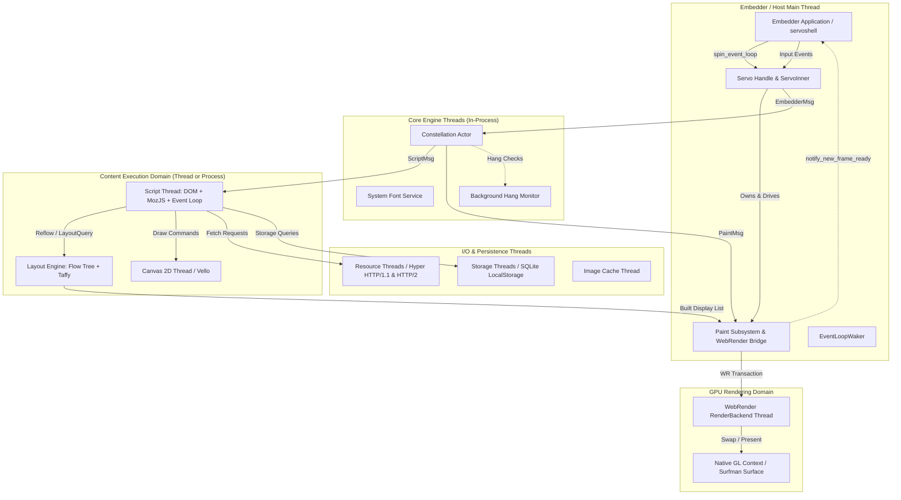
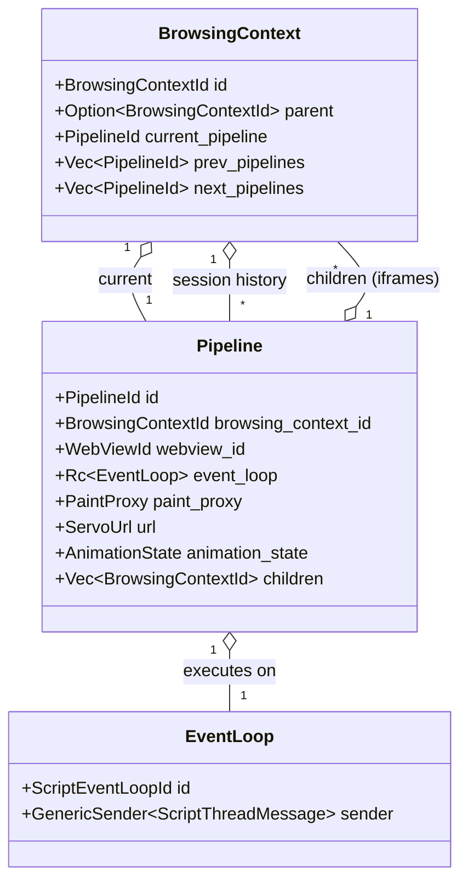
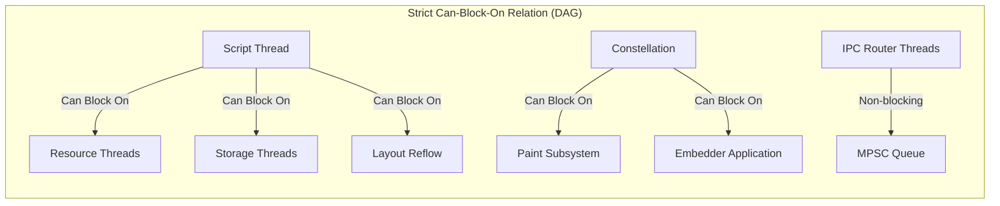

# 03 System Architecture: Servo Subsystem Topology & Concurrency Model

> **Evidence Status:** VERIFIED  
> **Source Commit:** `7ca9f80268a1d76e698560db82463e7960aa7845`  
> **Primary References:** `components/constellation/constellation.rs:5–86`, `components/servo/servo.rs:243–410`, `components/script/event_loop/script_thread.rs:5–20`, `components/layout/lib.rs`, `components/paint/lib.rs`  
> **Target Audience:** Asteria Architectural Engineering Team

---

## 1. High-Level Architectural Philosophy

Servo is an **actor-based, multi-threaded, and optionally multi-process browser engine**. Unlike traditional monolithic engines where DOM mutation, layout, and rendering occur on a single thread or through tight mutable sharing, Servo enforces strict architectural isolation:

1. **Independent Subsystem Actors:** Every major capability runs as an isolated actor communicating strictly via message passing.
2. **Interface Crate Decoupling:** Subsystems do not reference each other's concrete implementations. Every subsystem is split into an implementation crate (`components/<name>`) and a trait/API crate (`components/shared/<name>`).
3. **Deadlock Freedom by Design:** Inter-thread communication follows a strict DAG-ordered "Can-Block-On" hierarchy to prevent deadlocks across crossbeam and IPC channels.
4. **Isolated Memory Arenas:** DOM nodes reside in memory owned exclusively by the Script thread. Layout operates on read-only snapshots or trait-abstracted node interfaces (`LayoutNode`). Painting translates layout fragments into immutable display lists consumed by the GPU thread.

---

## 2. Global Concurrency & Thread Topology

The runtime consists of multiple concurrent execution domains running in parallel:

### 2.1 Thread Inventory & Ownership Boundaries

| Thread / Process Domain | Execution Location | Responsibility | Blocking Constraints |
| :--- | :--- | :--- | :--- |
| **Embedder Main Thread** | Host process | Drives UI event loop (`winit`), pumps `Servo::spin_event_loop()`, executes `Paint` updates, presents frames. | Can block on OS event loop; must never block on Script. |
| **Constellation Actor** | Dedicated thread | Owns frame forest, browsing contexts, session history, pipeline orchestration, crash reporting. | Can block on `Paint` and embedder; must never block on Script. |
| **Script Thread(s)** | Worker thread (or Content Process) | Executes JavaScript, maintains DOM arena, handles HTML parsing token stream, dispatches DOM events. | Can block on anything except other Script threads. |
| **Layout** | Synchronous to Script (or worker pool) | Computes box tree formatting, flex/grid constraints, inline line breaking, display lists. | Invoked by Script; parallel style resolution uses `rayon`. |
| **Paint Subsystem** | Runs on Embedder thread | Collects display lists from layout, manages WebRender document trees, handles pinch-zoom. | Direct in-memory access to embedder; receives async display lists. |
| **WebRender RenderBackend** | Dedicated thread in WebRender | Scene building, tile clipping, GPU primitive batching. | Managed internally by WebRender. |
| **Resource Threads (Net)** | Tokio runtime pool | Async HTTP/1.1, HTTP/2 fetching via `hyper`, disk cache, cookie jar. | Non-blocking async I/O; sends responses via channels. |
| **Storage Threads** | Worker thread | Synchronous SQLite transactions for localStorage / sessionStorage. | Executes disk I/O off the main script thread. |
| **System Font Service** | Background worker | Resolves font families, loads fallback font data from system. | Cached in-memory once loaded. |
| **Canvas Thread** | Dedicated thread | Rasterizes HTML5 `<canvas>` 2D context using `vello`. | Decoupled from DOM; script sends command buffers. |

---

## 3. The Grand Central Station: Constellation & Pipeline Forest

Verified in `components/constellation/constellation.rs:5–43`:

### 3.1 Core Abstractions Defined
1. **`BrowsingContext`:** The constellation's representation of a `WindowProxy`. Represents a viewport slot that can navigate over time. Top-level browsing contexts represent browser tabs or windows; nested browsing contexts represent `<iframe>` elements. Each browsing context maintains its own **session history** (back/forward list of pipelines).
2. **`Pipeline`:** The constellation's representation of an active `Window` document instance. It binds a URL, a document, its DOM arena, its layout state, and its rendering pipeline.
3. **`EventLoop`:** The constellation's representation of a Script thread. Multiple same-origin pipelines share the same `EventLoop` (allowing synchronous cross-window scripting per HTML5 spec). Different origins run on isolated `EventLoop` threads or separate processes.

---

## 4. Subsystem Boundaries & Interaction Contracts

### 4.1 Embedding & Shell Layer (`components/servo` + `ports/servoshell`)
- **Primary Boundary:** `Servo` and `WebView` structs wrap internal actor channels.
- **Inputs:** OS window events (`winit::event::WindowEvent`), keyboard/mouse inputs, navigation requests (`WebView::load()`).
- **Outputs:** Frame presentation requests (`WebViewDelegate::notify_new_frame_ready()`), cursor changes, title changes, modal dialog requests.
- **Communication:** Non-blocking crossbeam channel select (`EmbedderMessageSelector` in `servo.rs:180–236`).
- **Lifecycle:** Host creates `ServoBuilder::build()`, creates WebViews, repeatedly calls `Servo::spin_event_loop()`, and calls `WebView::paint()` when notified.

### 4.2 Script & DOM Subsystem (`components/script`)
- **Primary Boundary:** `ScriptThread` in `components/script/event_loop/script_thread.rs`.
- **Inputs:** Network response streams (`FetchResponseMsg`), user inputs (`ConstellationInputEvent`), timers (`TimerEvent`), constellation messages (`NewPipelineInfo`).
- **Outputs:** Reflow requests to Layout, draw commands to Canvas, fetch requests to Net, navigation requests to Constellation.
- **State & Invariants:** Owns the single-threaded DOM arena. JavaScript objects reference DOM nodes through `JS<T>` and `Root<T>` managed by SpiderMonkey's garbage collector. Traced via `#[dom_struct]` and `JSTraceable`.

### 4.3 Styling Subsystem (Stylo / Firefox CSS Engine)
- **Primary Boundary:** `style::stylist::Stylist` integrated through `components/shared/layout/lib.rs`.
- **Inputs:** DOM tree (`LayoutDomTypeBundle`), parsed stylesheets (`Stylesheet`), media query device metrics (`Device`).
- **Outputs:** `ComputedValues` attached to each element; `RestyleDamage` flags indicating what layout/paint caches are invalidated.
- **Concurrency:** Uses `rayon` (`StyleThreadPool`) to execute parallel bottom-up/top-down CSS rule matching across DOM subtrees.

### 4.4 Layout Subsystem (`components/layout`)
- **Primary Boundary:** `LayoutFactory` and `Layout` trait in `components/shared/layout/lib.rs:287–360`.
- **Inputs:** DOM tree wrapped in `LayoutNode` trait, computed styles (`ComputedValues`), viewport geometry (`ViewportDetails`), image dimensions from image cache.
- **Outputs:** Layout fragment tree, text line breaks, element bounding boxes, hit-test query answers, WebRender display list commands.
- **Algorithm Composition:**
  - Block & Inline Formatting: Handwritten flow tree in `components/layout/flow/`.
  - Flexbox & Grid: Solved using `taffy 0.14` (`components/layout/flex.rs`, `components/layout/grid.rs`).
  - Text Shaping: Measures text runs via `servo-fonts` and HarfBuzz.

### 4.5 Paint & Graphics Subsystem (`components/paint`)
- **Primary Boundary:** `Paint` struct in `components/paint/paint.rs` and `PaintProxy` in `components/shared/paint/lib.rs:52–83`.
- **Inputs:** Display lists from Layout (`PaintMessage::NewDisplayList`), animation tick requests, pinch-zoom gestures.
- **Outputs:** WebRender scene transactions (`webrender_api::Transaction`), buffer swap notifications to embedder.
- **Presentation Mechanics:** Runs on the embedder thread to access native OpenGL/EGL surface contexts directly, eliminating cross-thread GL context migrations.

### 4.6 Networking & Resource Loading (`components/net`)
- **Primary Boundary:** `FetchContext` and `new_resource_threads()` in `components/net/resource_thread.rs`.
- **Inputs:** `Request` structs specifying URL, headers, CORS mode, destination.
- **Outputs:** Streamed `ResponseBody` bytes sent back to script parsers via channels.
- **Protocol Handlers:** Extensible `ProtocolRegistry` supporting `http`, `https`, `file`, `data`, `blob`, and custom schemes registered by embedders.

---

## 5. Deadlock Prevention & Concurrency Invariants

Verified in `components/constellation/constellation.rs:63–86`:

### 5.1 Invariant Rules
1. **No Circular Blocking:** If thread $A$ can block on thread $B$, thread $B$ must never block on thread $A$.
2. **Constellation Isolation:** The Constellation coordinates crashes and must never block on an untrusted or potentially hanging Script thread.
3. **IPC Buffer Deadlock Avoidance:** Because IPC channels (`ipc-channel`) block when their OS pipe buffer fills up, all IPC receivers route messages through dedicated routing worker threads into unbounded in-memory crossbeam channels.

---

## 6. Panic Isolation & Fault Tolerance Architecture

1. **Script Panic Resilience:** If a Web page triggers a panic in `ScriptThread`, the panic is caught at the thread boundary. Constellation receives a disconnection event on the pipeline channel, dismantles the crashed pipeline, and sends `ServoDelegate::notify_error(LostConnectionWithBackend)` or renders an error page without crashing the browser shell.
2. **Background Hang Monitor (`components/background_hang_monitor`):**
   - Active worker threads send periodic heartbeats to the hang monitor.
   - If a script thread fails to check in within a configurable threshold (e.g., infinite JavaScript while loop), the monitor flags a `HangAlert` allowing the embedder to prompt the user to terminate the tab.
3. **Memory Pressure Relief (`components/malloc_size_of`):**
   - Every major struct implements `MallocSizeOf`.
   - Constellation triggers cooperative memory reports across all processes to detect leaks and flush image caches under OS memory pressure.

---

## 7. Direct Architectural Comparison: Servo vs. Asteria

| Architectural Dimension | Servo Architecture (Audited) | Asteria Architecture (Current State) | Architectural Evaluation for Asteria |
| :--- | :--- | :--- | :--- |
| **Engine Packaging** | 77 modular crates; strict interface crates (`components/shared/*`). | Single monolithic crate (`Asteria/Asteria/src/`). | **Recommendation:** Split Asteria into core engine, traits, and shell crates. |
| **Concurrency Model** | Multi-threaded actor pipeline (Constellation, Script, Paint, Net). | Single-threaded main loop with background worker pool. | **Recommendation:** Adopt pipeline/actor decoupling for smooth scrolling. |
| **CSS & Style Engine** | Stylo (parallel selector matching + computed values). | Custom handwritten parser in `style.rs` & `values.rs`. | **Recommendation:** Keep custom engine but adopt Stylo's computed style struct hierarchy. |
| **Layout Abstraction** | Flow tree + Taffy for Flex/Grid; abstract `LayoutNode` trait. | Recursive layout on concrete DOM arena nodes (`layout.rs`). | **Recommendation:** Decouple layout from DOM via abstract trait to fix inline/block bugs. |
| **Rendering Architecture**| WebRender retained display lists on OpenGL/Glow. | Immediate vertex buffer generation via `wgpu 22.1`. | **Recommendation:** Maintain `wgpu` backend, but adopt retained display list intermediate representation. |
| **Shell & Embedder** | `ServoBuilder` + `WebView` with embedder traits; `egui` chrome. | Monolithic `Shell` struct mixed with `winit` event loop. | **Recommendation:** Extract `WebView` abstraction; isolate browser UI from webpage rendering. |
