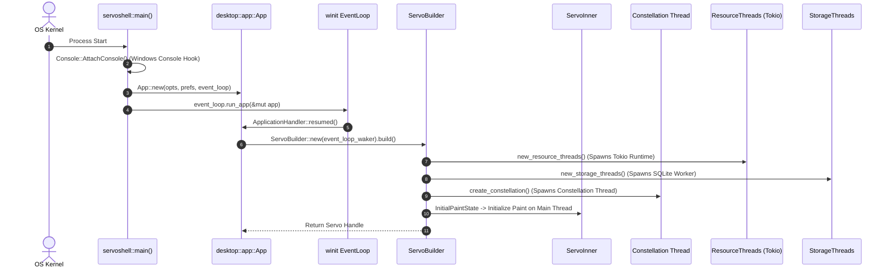
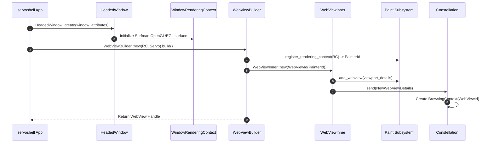
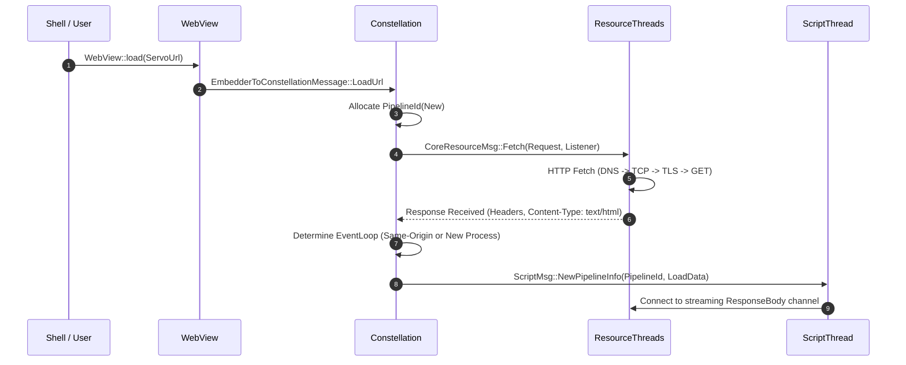
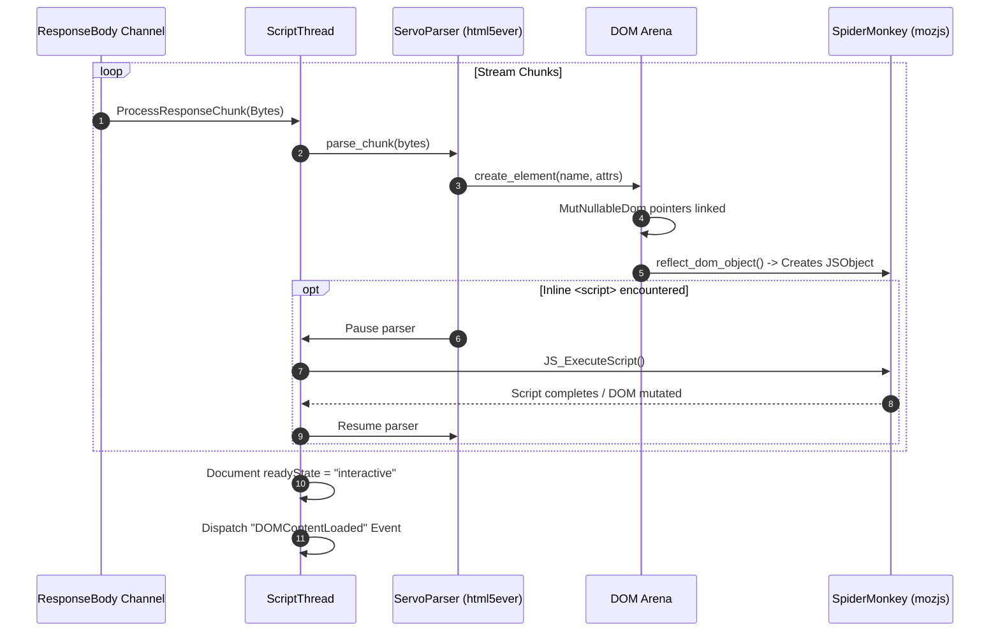
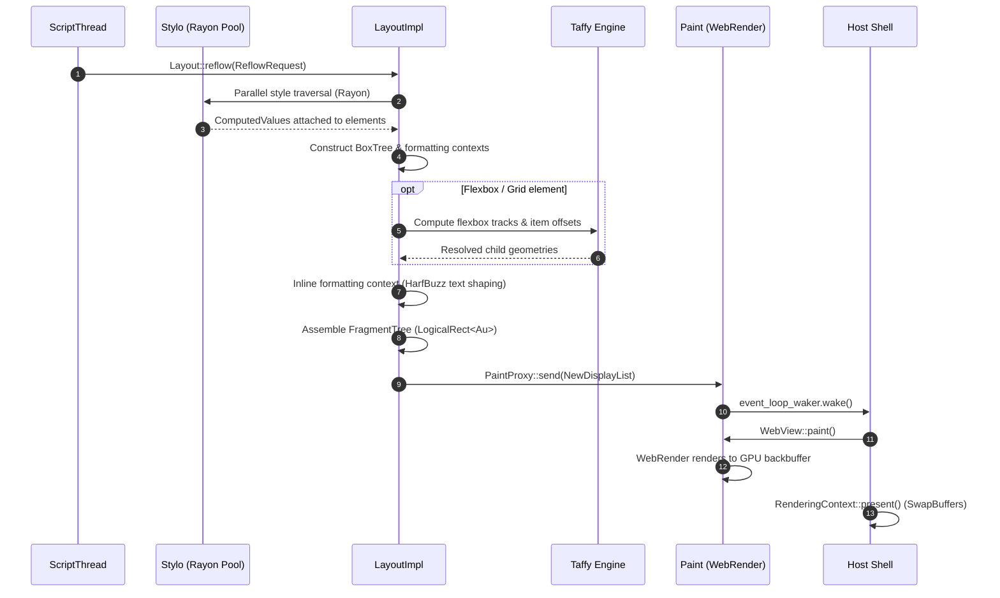
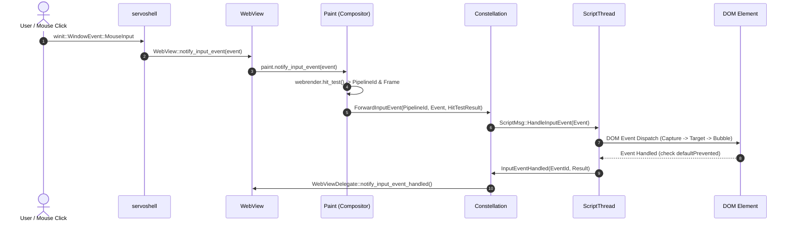
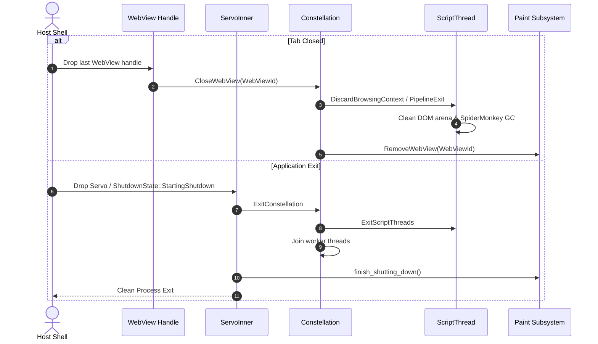

# 04 End-to-End Traced Runtime Flows in Servo

> **Evidence Status:** VERIFIED  
> **Source Commit:** `7ca9f80268a1d76e698560db82463e7960aa7845`  
> **Audited Modules:** `ports/servoshell`, `components/servo`, `components/constellation`, `components/script`, `components/layout`, `components/paint`, `components/net`  
> **Target Subsystems:** Startup, WebView Embedding, Navigation, HTML/DOM/JS, Style/Layout/Paint, Input, Teardown

---

## Flow 1: Engine Startup and Initialization

### 1.1 Architectural Overview
Initializes platform consoles, cryptographic primitives, tracing infrastructure, the host event loop, and starts the core engine threads.

### 1.2 Step-by-Step Execution Trace
1. **Console Attachment (`ports/servoshell/main.rs:20–33`):**
   - On Windows, executes `Console::FreeConsole()` and `Console::AttachConsole(ATTACH_PARENT_PROCESS)` so standard output attaches to the launching terminal.
2. **Crypto & Tracing Bootstrap (`ports/servoshell/lib.rs:44–75`):**
   - Calls `rustls::crypto::aws_lc_rs::default_provider().install_default()` to set up TLS.
   - Sets up Perfetto tracing layer (`init_tracing`) if compiled with profiling.
3. **Event Loop Hook (`ports/servoshell/desktop/app.rs:53–120`):**
   - Instantiates `App` implementing `winit::application::ApplicationHandler`.
   - On `ApplicationHandler::resumed()`, checks if `AppState::Initializing` and builds `Servo`.
4. **Engine Thread Orchestration (`components/servo/servo.rs:970–1241`):**
   - `create_paint_channel()` creates the main thread `PaintProxy`.
   - `new_resource_threads()` spawns asynchronous network I/O workers on Tokio.
   - `new_storage_threads()` spawns SQLite client storage threads.
   - `create_constellation()` spawns the central supervisor thread.
5. **Asteria Implication:** Asteria currently launches everything synchronously on the main thread in `main.rs`. Adopting this phased startup sequence prevents initial window stutter.

---

## Flow 2: Creating and Embedding a WebView

### 2.1 Architectural Overview
Binds a native OS window surface to an abstract `RenderingContext`, registers painter handles, and requests frame creation from the Constellation.

### 2.2 Step-by-Step Execution Trace
1. **Window & Surface Setup (`ports/servoshell/desktop/headed_window.rs:115–180`):**
   - Uses `winit::window::Window` to acquire a native handle (`raw-window-handle`).
   - Uses `surfman` to bind an OpenGL/EGL hardware context (`WindowRenderingContext`).
2. **WebView Allocation (`components/servo/webview.rs:154–205`):**
   - `WebView::new()` calls `servo.paint_mut().register_rendering_context()`, allocating a unique `PainterId`.
   - Derives `WebViewId::new(painter_id)`.
   - Wraps state in `Rc::new(RefCell::new(WebViewInner))`.
3. **Constellation Registration (`components/servo/webview.rs:208–225`):**
   - Sends `NewWebViewDetails` to Constellation.
   - Constellation creates a root `BrowsingContext` with no initial active pipeline.
4. **Asteria Implication:** In Asteria, the window and rendering context are hardcoded to a single viewport in `src/shell.rs`. Adopting `WebViewBuilder` allows Asteria to support multi-tab browsing and multi-window environments natively.

---

## Flow 3: Navigation and Resource Loading

### 3.1 Architectural Overview
Traces initiating a URL load through Constellation routing, asynchronous network fetching, MIME sniffing, and pipeline instantiation.

### 3.2 Step-by-Step Execution Trace
1. **Navigation Request (`components/servo/webview.rs:293–315`):**
   - `WebView::load()` packages a `LoadData` struct with URL, referrer, and reload flags.
   - Dispatches `EmbedderToConstellationMessage::LoadUrl` to Constellation.
2. **Pipeline Allocation (`components/constellation/constellation.rs:2250–2320`):**
   - Constellation allocates a globally unique `PipelineId`.
   - Dispatches `CoreResourceMsg::Fetch` with destination `Destination::Document`.
3. **Network Transport (`components/net/http_loader.rs`):**
   - Hyper dispatches async request over connection pool.
   - Response headers arrive; `Mime` type is sniffed (`text/html`).
   - Notifies Constellation that headers are ready.
4. **Script Pipeline Binding (`components/script/event_loop/script_thread.rs:1120–1180`):**
   - Constellation sends `NewPipelineInfo` to target `ScriptThread`.
   - `ScriptThread` initializes a new `Document`, `Window`, and connects an `html5ever` parser sink to the incoming response body byte channel.
5. **Asteria Implication:** Asteria's current navigation in `src/shell.rs` blocks the main thread waiting for HTTP response bytes. Servo's pipeline allocation decouples network wait times from UI responsiveness.

---

## Flow 4: HTML Parsing, DOM Construction & Script Execution

### 4.1 Architectural Overview
Traces streaming HTML chunks into tokenizers, instantiating DOM nodes with JS reflectors, and pausing for inline `<script>` tags.

### 4.2 Step-by-Step Execution Trace
1. **Streaming Input (`components/script/dom/servoparser/mod.rs`):**
   - `ProcessResponseChunk` feeds byte slices to `html5ever::tokenizer::Tokenizer`.
2. **Tree Building (`components/script/dom/servoparser/html.rs`):**
   - `html5ever::tree_builder::TreeSink` calls `create_element()`.
   - Allocates `Node` + `Element` structs; updates `MutNullableDom` sibling and parent links in $O(1)$.
3. **JS Reflection (`components/script_bindings/reflector.rs`):**
   - Allocates a mirrored JS object in SpiderMonkey via `reflect_dom_object_with_proto()`.
   - Connects private pointer from JS object to Rust `DomObject`.
4. **Script Execution Interruption (`components/script/dom/html/htmlscriptelement.rs`):**
   - Inline `<script>` execution halts the parser per HTML5 specifications.
   - Executes JavaScript; mutations immediately modify the live DOM tree.
   - Once executed, parser resumes where it left off.
5. **Asteria Implication:** Asteria parses the entire HTML string at once into `Vec<Node>` in `src/parser.rs`. Adopting incremental streaming parsing prevents initial page load freezes on large documents.

---

## Flow 5: Style Cascade, Layout Reflow & Painting

### 5.1 Architectural Overview
Traces restyle dirty flags triggering Stylo parallel cascade, Box Tree construction, Taffy flexbox layout, HarfBuzz text shaping, and WebRender display list generation.

### 5.2 Step-by-Step Execution Trace
1. **Reflow Invalidation (`components/script/event_loop/script_thread.rs:2450–2510`):**
   - Script thread checks `needs_reflow` flags and calls `Layout::reflow()`.
2. **Stylo Parallel Restyle (`components/layout/layout_impl.rs:320–380`):**
   - Stylo traverses the DOM using `rayon` worker threads.
   - Evaluates selectors; attaches immutable `ServoArc<ComputedValues>` to each element.
3. **Box Tree & Taffy Formatting (`components/layout/taffy/mod.rs`):**
   - Box tree partitions elements into formatting contexts.
   - Block formatting handles margins and line breaks.
   - Modern flexbox containers pass constraints into `taffy::compute_layout()`.
4. **Fragment Tree Generation (`components/layout/fragment_tree/`):**
   - Assembles resolved physical `BoxFragment`s in integer `AppUnits` (`Au`).
5. **Display List Compilation (`components/layout/display_list/`):**
   - Compiles fragments into `webrender_api::BuiltDisplayList`.
   - Sends display list asynchronously via `PaintProxy`.
6. **Frame Presentation (`components/servo/servo.rs:382–392`):**
   - Host calls `WebView::paint()`; WebRender draws to GPU backbuffer; `present()` executes swapbuffers.
7. **Asteria Implication:** Directly addresses Asteria's `FLAWS.md:1.5–1.7`. Separating layout into Stylo cascade $\rightarrow$ Box Tree $\rightarrow$ Taffy $\rightarrow$ Fragment Tree $\rightarrow$ Display List resolves containing block errors and double-layout bugs permanently.

---

## Flow 6: Input Event Processing and Compositor Hit-Testing

### 6.1 Architectural Overview
Traces user mouse/keyboard input through OS event loops, compositor-level hit testing, Constellation routing, and DOM event bubbling.

### 6.2 Step-by-Step Execution Trace
1. **Event Interception (`ports/servoshell/desktop/headed_window.rs:450–520`):**
   - `winit` mouse click converted to `embedder_traits::InputEvent`.
2. **Spatial Hit-Testing Branch (`components/servo/webview.rs:621–636`):**
   - Events with coordinates (`point.is_some()`) route to `Paint`.
   - WebRender tests coordinates against GPU clipping nodes and transforms.
3. **Constellation Dispatch (`components/constellation/constellation.rs:3100–3140`):**
   - Constellation targets the exact active `PipelineId` associated with the clicked frame.
4. **DOM Dispatch Algorithm (`components/script/dom/node/node.rs`):**
   - Script converts event to DOM `MouseEvent`.
   - Traverses ancestors from `Document` down to target node (Capture Phase).
   - Fires listeners on target (Target Phase).
   - Traverses ancestors back to `Document` (Bubble Phase).
5. **Acknowledgement (`components/servo/servo.rs:321–340`):**
   - Returns acknowledgement to embedder to decide if native fallback actions run.
6. **Asteria Implication:** Asteria currently tests hits via linear rectangle loops in `src/selection.rs`. WebRender compositor hit-testing allows accurate clicks even on rotated, scaled, or overlapping layers.

---

## Flow 7: Teardown, Tab Closing & Engine Shutdown

### 7.1 Architectural Overview
Traces graceful shutdown when a tab is closed or the host application exits, ensuring zero leaked memory and clean thread joining.

### 7.2 Step-by-Step Execution Trace
1. **Tab Destruction (`components/servo/webview.rs:144–151`):**
   - When the embedder drops its `WebView` handle, `WebViewInner::drop` triggers automatically.
   - Sends `EmbedderToConstellationMessage::CloseWebView` and `Paint::remove_webview()`.
2. **Pipeline Garbage Collection (`components/constellation/constellation.rs:1420–1490`):**
   - Constellation tears down child frame trees and sends exit messages to associated script event loops.
3. **Application Exit (`components/servo/servo.rs:409–414`):**
   - When `Servo` drops, `shutdown_state` transitions to `FinishedShuttingDown`.
   - All worker threads (Net, Storage, Constellation, Paint) receive shutdown signals and join cleanly.
4. **Asteria Implication:** Asteria currently lacks structured teardown; closing a tab leaves resources dangling in global vectors. Implementing drop-based channel teardown prevents memory leaks.
