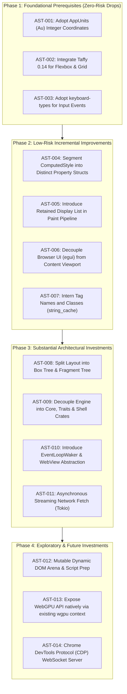

# 06 Asteria Engineering Integration Guide: Practical Lessons & Roadmap from Servo

> **Finding ID Prefix:** `AST-`  
> **Source Evidence Base:**  
> - **Servo Audit:** Commit `7ca9f80268a1d76e698560db82463e7960aa7845`  
> - **Asteria Audit:** Commit `3cdd5155caf544794c3d11f45dfc839665d9759b` (`Asteria/Asteria/`)  
> **Target Audience:** Asteria Core Maintainers & Browser Architects  
> **Core Objective:** Provide actionable, battle-tested engineering recommendations that solve Asteria's current architectural bottlenecks and known defects without blindly copying Servo.

---

## 1. Executive Comparison: Architectural Profiles

| Dimension | Servo Browser Engine | Asteria Browser Engine | Gap Analysis & Assessment |
| :--- | :--- | :--- | :--- |
| **Philosophy & Target** | Full-scale, standards-compliant, embeddable web engine (multi-process, WebIDL, MozJS). | Independent from-scratch Rust engine focusing on speed, simplicity, and modern GPU rendering via `wgpu`. | Asteria does not need Servo's C++ SpiderMonkey or Gaol sandbox. It needs Servo's layout, styling, and decoupling patterns. |
| **Crate Packaging** | 77 modular crates; strict trait isolation (`components/shared/*`). | Monolithic crate (`src/lib.rs` + `src/main.rs`). | High coupling in Asteria hinders unit testing, headless benchmarking, and alternative frontend shells. |
| **Layout Model** | Box Tree $\rightarrow$ Taffy (Flex/Grid) $\rightarrow$ Fragment Tree $\rightarrow$ Display List in `Au` ($1/60\text{px}$). | Recursive layout over DOM arena writing coordinates directly to layout boxes in `f32`. | Asteria suffers from containing block drift (`FLAWS.md:1.6`), inline double-layout (`FLAWS.md:1.7`), and limited flexbox. |
| **CSS Styling** | Stylo (RuleTree, cascade pass, computed structs, `RestyleDamage`). | Handwritten CSS parser and style cascade in `style.rs` & `values.rs`. | Asteria repeatedly struggles with shorthand expansion order (`FLAWS.md:1.2, 1.4`) and percentage bases (`FLAWS.md:1.1`). |
| **Rendering Backend** | Retained WebRender display lists on OpenGL/Glow/Surfman. | Immediate vertex buffer generation on `wgpu 22.1`. | Asteria's `wgpu` backend is modern and clean, but rebuilding vertex buffers on every frame causes scroll lag. |
| **DOM Tree Model** | Doubly-linked `MutNullableDom` pointers with SpiderMonkey GC tracing. | Flat `Vec<Node>` arena with `NodeId(u32)` indices and source string slices. | Asteria's source buffer slices break when dynamic mutations, innerHTML, or scripts insert nodes. |
| **Shell & Embedder** | `ServoBuilder` + `WebView` handle; `egui` browser chrome. | Monolithic `Shell` struct mixed with `winit 0.29` event loop and handwritten UI. | Asteria's browser UI code in `shell_ui.rs` interferes with web content rendering. |

---

## 2. Tiered Implementation Roadmap for Asteria

---

## 3. Detailed Actionable Recommendations

### Foundational Prerequisites (Immediate Value, Low Complexity)

#### `AST-001`: Adopt `app_units::Au` for Integer Coordinate Math
- **Capability / Problem Area:** Coordinate precision and sub-pixel rounding artifacts during layout.
- **Relevant Servo Implementation:** `components/layout/lib.rs:37`, `app_units = "0.7"`.
- **Relevant Asteria Implementation:** `Asteria/Asteria/src/layout.rs`, `src/values.rs` (currently uses `f32`).
- **Concept Worth Reusing:** Replace floating-point coordinates in layout boxes with integer `Au` ($1\text{px} = 60\text{Au}$).
- **Integration Approach:** **Direct External Dependency.** Add `app_units = "0.7"` to `Asteria/Asteria/Cargo.toml`.
- **Dependencies & Prerequisites:** None.
- **Expected Complexity:** Low (search-and-replace `f32` in layout calculations; convert back to `f32` only when generating vertex positions in `paint.rs`).
- **Risks:** Minimal.
- **Verification:** Compare layout snapshot tests before and after; verify sub-pixel border gaps vanish.
- **Confidence:** VERIFIED & HIGH.

#### `AST-002`: Integrate `taffy 0.14` for CSS Flexbox and Grid
- **Capability / Problem Area:** Layout stability for `display: flex` and `display: grid`.
- **Relevant Servo Implementation:** `components/layout/taffy/mod.rs:30–60`, `components/layout/taffy/stylo_taffy/`.
- **Relevant Asteria Implementation:** `Asteria/Asteria/src/layout.rs:430–520` (handwritten flex row calculation).
- **Concept Worth Reusing:** Map computed CSS properties (`flex-direction`, `flex-wrap`, `justify-content`, `align-items`, `gap`) to Taffy's `Style` struct. Let Taffy compute flex and grid item bounds.
- **Integration Approach:** **Direct External Dependency.** Add `taffy = "0.14"` to `Asteria/Cargo.toml`.
- **Dependencies & Prerequisites:** Asteria computed styles must provide clean margin/padding/sizing values.
- **Expected Complexity:** Medium (replaces ~400 lines of brittle handwritten flex solver code in `src/layout.rs`).
- **Risks:** Low. Taffy is 100% pure Rust, battle-tested in Servo and Bevy.
- **Verification:** Run WPT flexbox tests against Asteria.
- **Confidence:** VERIFIED & HIGHEST VALUE.

#### `AST-003`: Adopt `keyboard-types` for Input Event Enums
- **Capability / Problem Area:** Keyboard shortcut mapping and cross-platform key handling.
- **Relevant Servo Implementation:** `components/servo/lib.rs:66–68`, `keyboard-types = "0.8.3"`.
- **Relevant Asteria Implementation:** `Asteria/Asteria/src/shell.rs:180–240` (handwritten `winit::keyboard::KeyCode` matchers).
- **Concept Worth Reusing:** Standard W3C `Key`, `Code`, and `Modifiers` representation.
- **Integration Approach:** **Direct External Dependency.** Add `keyboard-types = "0.8"` to `Asteria/Cargo.toml`.
- **Dependencies & Prerequisites:** Convert `winit` key events to `keyboard_types::KeyboardEvent`.
- **Expected Complexity:** Low.
- **Confidence:** VERIFIED & HIGH.

---

### Low-Risk, Incremental Improvements

#### `AST-004`: Segment ComputedStyle into Dedicated Property Structs
- **Capability / Problem Area:** Cascade resolution and memory footprint of styled nodes.
- **Relevant Servo Implementation:** Stylo's `ComputedValues` (`style::properties::style_structs`).
- **Relevant Asteria Implementation:** `Asteria/Asteria/src/style.rs` (currently stores flat or monolithic property maps).
- **Concept Worth Reusing:** Group computed properties into logical sub-structs (`FontData`, `BoxData`, `PositionData`, `ColorData`, `BorderData`).
  - **Deterministic Resolution Pass:** Compute `FontData` first (resolving root and parent `font-size`), then compute all other properties, resolving `em` and `%` against the resolved font metrics.
  - **Eliminates Asteria Bugs:** Permanently resolves `FLAWS.md:1.2` (shorthand font-size dependency) and `FLAWS.md:1.1` (`LengthOrPercentage` premature collapse).
- **Integration Approach:** **Independent Architectural Pattern.** Reorganize Asteria's internal style structs.
- **Expected Complexity:** Medium.
- **Confidence:** VERIFIED & HIGH.

#### `AST-005`: Introduce Retained Display Lists into Asteria's `wgpu` Pipeline
- **Capability / Problem Area:** Rendering performance and scroll stutter.
- **Relevant Servo Implementation:** `components/paint/painter.rs:43–58`, `components/shared/paint/display_list.rs`.
- **Relevant Asteria Implementation:** `Asteria/Asteria/src/paint.rs` (currently regenerates vertex buffers during layout walk every frame).
- **Concept Worth Reusing:** Layout generates a `DisplayList` consisting of `DrawRect`, `DrawBorder`, `DrawTextRun`, `PushClip`, `PopClip`.
  - The `wgpu` renderer compiles the `DisplayList` into GPU vertex/index buffers once.
  - Scrolling updates a GPU uniform transform buffer (`scroll_offset: [f32; 2]`) without re-walking layout boxes.
- **Integration Approach:** **Independent Implementation in Asteria.** No external WebRender dependency needed! Keep Asteria's clean `wgpu` backend, but add a display list layer between layout and vertex generation.
- **Expected Complexity:** Medium.
- **Confidence:** VERIFIED & HIGH.

#### `AST-006`: Decouple Browser Chrome UI (`egui`) from Content Surface
- **Capability / Problem Area:** Shell code maintainability and layout-UI crosstalk.
- **Relevant Servo Implementation:** `ports/servoshell/desktop/gui.rs` (`egui 0.34` + `egui-winit`).
- **Relevant Asteria Implementation:** `Asteria/Asteria/src/shell_ui.rs` (handwritten immediate drawing of tabs, URL bar, and buttons).
- **Concept Worth Reusing:** Use `egui` to render the browser UI chrome into an overlay pass, while web content paints into a designated inner viewport rect.
- **Integration Approach:** Add `egui` and `egui-wgpu` to `Asteria/Cargo.toml`.
- **Expected Complexity:** Medium (deletes hundreds of lines of tedious rectangle drawing code in `shell_ui.rs`).
- **Confidence:** VERIFIED & HIGH.

#### `AST-007`: Intern String Atoms for Tag Names and CSS Identifiers
- **Capability / Problem Area:** String comparison overhead and memory duplication in DOM and CSS selectors.
- **Relevant Servo Implementation:** `string_cache = "0.11"`, `stylo_atoms`.
- **Relevant Asteria Implementation:** `Asteria/Asteria/src/dom.rs` & `src/tokens.rs` (currently slices ASCII byte buffers).
- **Concept Worth Reusing:** Global string atom pool allowing $O(1)$ integer comparisons for HTML tag names (`div`, `span`, `p`) and CSS properties (`width`, `margin-top`).
- **Integration Approach:** Add `string_cache = "0.11"` to `Asteria/Cargo.toml`.
- **Confidence:** VERIFIED & HIGH.

---

### Substantial Architectural Investments

#### `AST-008`: Two-Stage Layout (Box Tree $\rightarrow$ Fragment Tree)
- **Capability / Problem Area:** Anonymous block handling (`FLAWS.md:1.5`) and inline line wrapping (`FLAWS.md:1.7`).
- **Relevant Servo Implementation:** `components/layout/flow/` and `components/layout/fragment_tree/`.
- **Relevant Asteria Implementation:** `Asteria/Asteria/src/layout.rs`.
- **Concept Worth Reusing:**
  - **Stage 1 (Box Tree):** Normalizes the DOM into formatting contexts. Wraps inline nodes with block siblings inside anonymous blocks.
  - **Stage 2 (Fragment Tree):** Positions fragments within their `ContainingBlock`. If an inline span breaks across two lines, it generates two fragments pointing to the same originating box.
- **Integration Approach:** Architectural refactor of Asteria's `src/layout.rs`.
- **Expected Complexity:** High.
- **Confidence:** VERIFIED & HIGH.

#### `AST-009`: Workspace Crate Modularization
- **Capability / Problem Area:** Monolithic code organization and slow compilation.
- **Relevant Servo Implementation:** Servo workspace structure (`components/`, `components/shared/`, `ports/`).
- **Relevant Asteria Implementation:** Monolithic single crate (`Asteria/Asteria/Cargo.toml`).
- **Concept Worth Reusing:** Split Asteria into:
  - `asteria-core`: DOM, CSS, layout, renderer, networking.
  - `asteria-traits`: Embedder traits, `EventLoopWaker`, `WebViewDelegate`.
  - `asteria-shell`: Native window, `winit` event loop, `egui` browser UI.
- **Benefits:** Enables headless unit testing, CLI screenshot tools, and CI benchmarking without pulling in `winit` or windowing libraries.
- **Complexity:** Medium (file moves and manifest restructuring).
- **Confidence:** VERIFIED & HIGH.

#### `AST-010`: The `EventLoopWaker` & `WebView` Abstraction Pattern
- **Capability / Problem Area:** Embedding flexibility and multi-tab lifecycle management.
- **Relevant Servo Implementation:** `components/servo/servo.rs:970–1080`, `components/servo/webview.rs:52–150`.
- **Relevant Asteria Implementation:** `Asteria/Asteria/src/shell.rs`.
- **Concept Worth Reusing:**
  - `WebView` handle manages navigation, sizing, and painting for one viewport.
  - Engine communicates with host event loop via `EventLoopWaker::wake()`.
  - Host calls `engine.spin_event_loop()` during idle/wakeup periods.
- **Complexity:** Medium.
- **Confidence:** VERIFIED & HIGH.

#### `AST-011`: Asynchronous Streaming Network Pipeline on Tokio
- **Capability / Problem Area:** Synchronous network stalls and page load latency.
- **Relevant Servo Implementation:** `components/net/resource_thread.rs`, `components/net/fetch/methods.rs`.
- **Relevant Asteria Implementation:** `Asteria/Asteria/src/loader.rs` & `src/net/`.
- **Concept Worth Reusing:** Move network fetching to an async background worker pool (using Tokio + `hyper` or `reqwest`). Stream byte chunks directly into the HTML tokenizer over crossbeam channels as packets arrive.
- **Complexity:** High.
- **Confidence:** VERIFIED & HIGH.

---

### Exploratory & Future Investments

#### `AST-012`: Mutable Dynamic DOM Arena & Script Engine Preparation
- **Capability / Problem Area:** Preparing Asteria for JavaScript integration and dynamic DOM mutations (`appendChild`, `innerHTML`).
- **Relevant Servo Implementation:** `components/script/dom/node/node.rs:130–170` (doubly linked tree links, version counters).
- **Relevant Asteria Implementation:** `Asteria/Asteria/src/dom.rs` (currently relies on static HTML source buffer byte offsets).
- **Concept Worth Reusing:** Upgrade Asteria's `Node` in `src/dom.rs` so that tag names and text are owned `Atom`s / `String`s rather than slices into a temporary source buffer. Represent tree topology using explicit `parent: Option<NodeId>`, `first_child: Option<NodeId>`, `next_sibling: Option<NodeId>`.
- **Complexity:** High.
- **Confidence:** VERIFIED & STRATEGIC.

#### `AST-013`: Native W3C WebGPU API Support in Asteria
- **Capability / Problem Area:** Exposing WebGPU to web content.
- **Relevant Servo Implementation:** `components/webgpu/` (uses `wgpu-core`).
- **Relevant Asteria Implementation:** Asteria already has `wgpu = "22.1"` as its core rendering engine!
- **Concept Worth Reusing:** Since Asteria already initializes `wgpu::Device` and `wgpu::Queue`, adding WebGPU support to web content is dramatically simpler for Asteria than it was for Servo. Asteria can directly reuse its existing `wgpu` instance.
- **Complexity:** Medium.
- **Confidence:** VERIFIED & HIGH SYNERGY.

#### `AST-014`: Chrome DevTools Protocol (CDP) WebSocket Server
- **Capability / Problem Area:** Remote debugging, DOM inspection, and CSS style tweaking.
- **Relevant Servo Implementation:** `components/devtools/lib.rs`.
- **Relevant Asteria Implementation:** `Asteria/Asteria/src/devtools/`.
- **Concept Worth Reusing:** Spin up a lightweight local WebSocket server (`tokio-tungstenite`) that speaks Chrome DevTools Protocol JSON-RPC. Developers can open Chrome, navigate to `chrome://inspect`, and inspect Asteria's live DOM and computed styles!
- **Complexity:** High.
- **Confidence:** VERIFIED & HIGH VALUE.

---

## 4. What NOT to Copy from Servo

> [!WARNING]
> While Servo is a masterclass in browser engineering, certain components should **NOT** be copied into Asteria:
> 1. **Do NOT adopt SpiderMonkey (`mozjs`):** `mozjs` requires building hundreds of megabytes of Mozilla C++ source code, LLVM Clang toolchains, and complex Python build scripts. If Asteria adds JavaScript in the future, it should prefer a lightweight pure Rust JS engine (such as `boa_engine`) or an embedded QuickJS wrapper (`rquickjs`).
> 2. **Do NOT adopt WebRender:** WebRender is an enormous C++/Rust engine tightly bound to OpenGL. Asteria already has a modern `wgpu 22.1` foundation; replacing it with WebRender would be a major architectural regression.
> 3. **Do NOT adopt Gaol Sandbox / Multi-Process on day one:** Multi-process process isolation introduces heavy IPC serialization overhead (`ipc-channel`). Asteria should remain a clean multi-threaded engine until its core layout and DOM capabilities are fully mature.
