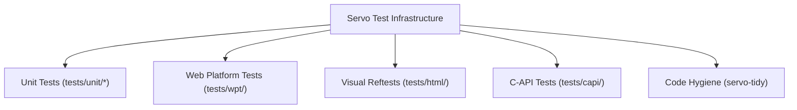

# 08 Testing, Build & Debugging Engineering Reference

> **Evidence Status:** VERIFIED  
> **Source Commit:** `7ca9f80268a1d76e698560db82463e7960aa7845`  
> **Audited Tooling:** `mach.ps1`, `python/servo/`, `Cargo.toml`, `tests/`  
> **Target Audience:** Asteria Developers Building and Testing Browser Engine Components

---

## 1. Build System Architecture & Tooling

Servo utilizes a Python orchestrator (`mach`) backed by Astral `uv` to manage build dependencies, WebIDL codegen, and test execution without polluting the host Python environment.

### 1.1 Core Build Commands
```powershell
# Windows PowerShell build commands from repository root:
.\mach.ps1 build                        # Standard debug build (default member: servoshell)
.\mach.ps1 build --release              # Production optimized build
.\mach.ps1 build -p servo               # Builds only the embedding library
.\mach.ps1 run https://example.com      # Launches servoshell with target URL
```

### 1.2 Cargo Profiles Defined (`Cargo.toml:392–447`)
- `dev`: Standard development profile; sets `opt-level = 3` for `crypto-bigint` and restricts `servo-script` to `codegen-units = 16` to prevent Windows 4GB `.rlib` linker limits.
- `checked-release`: Release optimizations (`opt-level = 3`) with assertions enabled for CI performance validation.
- `medium`: Fast incremental rebuild profile (`opt-level = 2`, `debug = "line-tables-only"`).
- `production`: Fully stripped, LTO (`lto = true`), single codegen unit (`codegen-units = 1`), optimized for size (`opt-level = "s"`).

---

## 2. Test Infrastructure & Execution Strategies



### 2.1 Targeted Unit Testing
To avoid rebuilding the entire 77-crate workspace, run targeted unit tests:
```powershell
# Run style unit tests:
cargo test -p style_tests

# Run layout unit tests:
cargo test -p servo-layout

# Run script unit tests:
cargo test -p script_tests

# Run profile unit tests:
cargo test -p profile_tests
```

### 2.2 Web Platform Tests (WPT)
Servo runs upstream W3C conformance suites via `wptrunner`:
```powershell
.\mach.ps1 test-wpt tests/wpt/web-platform-tests/css/css-flexbox/
.\mach.ps1 test-wpt tests/wpt/web-platform-tests/html/dom/
```
- **Asteria Recommendation:** Asteria should adopt the same WPT test files for CSS Flexbox and Box Layout to objectively measure spec compliance against Servo and Chrome.

### 2.3 Visual Reftests (`test-ref`)
Compares rendered HTML against reference HTML or PNG snapshots:
```powershell
.\mach.ps1 test-ref tests/html/reftests.list
```

### 2.4 Code Hygiene (`test-tidy`)
```powershell
.\mach.ps1 test-tidy                    # Checks formatting, license headers, and cargo deny
```

---

## 3. Diagnostics, Logging & Debugging

### 3.1 Environment Logging (`RUST_LOG`)
Servo uses standard `log` and `env_logger`:
```powershell
$env:RUST_LOG="servo=debug,servo_layout=trace,servo_paint=info"
.\mach.ps1 run https://example.com
```

### 3.2 Perfetto Performance Tracing
Compiled with `--features tracing-perfetto`:
- Emits binary trace log `servo.pftrace` during execution.
- Can be uploaded directly to [ui.perfetto.dev](https://ui.perfetto.dev) for interactive microsecond-level CPU flame graphs and thread synchronization profiling.

### 3.3 WebRender Visual Debugging Overlays
Enabled via command line flags or runtime preferences:
- `--debug-webrender-profiler`: Real-time frame time overlay.
- `--debug-webrender-texture-cache`: Visualizes GPU texture atlas allocations.
- `--debug-webrender-render-targets`: Visualizes offscreen pass render targets.

---

## 4. Resource-Conscious CI Verification for Asteria

1. **Avoid Full Rebuilds:** Never run unconstrained `cargo test --workspace` on a complete browser engine in CI; it consumes tens of gigabytes of RAM and takes 30+ minutes.
2. **Prioritize Targeted Subsystem Tests:**
   - Run CSS parser unit tests.
   - Run layout fragment geometry snapshot tests.
   - Run HTML tokenizer conformance tests against html5lib-tests.
