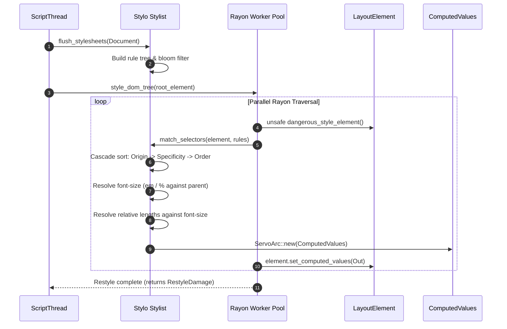

# Subsystem Report: 05 Styling, Selector Matching & Stylo Integration

> **Finding ID Prefix:** `SUB-STY-`  
> **Target Subsystem:** CSS Cascading, Selector Matching, Style Resolution & Restyle Invalidation  
> **Audited Crates:** Stylo integration (`style`, `selectors`, `servo_arc`), `components/shared/layout` (`servo-layout-api`), `components/layout` (`servo-layout`)  
> **Evidence Status:** VERIFIED against source tree (`7ca9f80268a1d76e698560db82463e7960aa7845`)  
> **Relevance to Asteria:** CRITICAL (Resolving Asteria's cascade ordering, shorthand expansions, and selector bugs)

---

## A. Purpose and Design

The Styling Subsystem is powered by **Stylo** (the parallel CSS engine co-developed by Mozilla and Servo for Firefox). Its responsibility is to take raw CSS text and author stylesheets, construct an optimized rule index, evaluate selectors against the DOM tree, resolve the CSS cascade (inheritance, origins, specificity, `!important`), and output immutable `ComputedValues` attached to layout nodes.

### Architectural Invariants:
1. **Parallel Style Computation:** Style resolution runs across multiple threads using `rayon` (`StyleThreadPool`). DOM subtrees are processed concurrently from the top down.
2. **Encapsulated DOM Traversal (`DangerousStyleElement`):** During normal layout, accessing parent nodes is disallowed to avoid race conditions. Selector matching is the sole exception (needs ancestors for `.parent > .child`); this is strictly isolated in `DangerousStyleElement` (`layout_element.rs:55–68`).
3. **Restyle Invalidation Damage:** DOM attribute changes don't blindly recompute styles for the entire page. Stylo calculates `RestyleDamage` bitflags (e.g., `REBUILD_AND_REFLOW`, `REFLOW_ONLY`, `PAINT_ONLY`), minimizing expensive downstream work.
4. **Shared Computed Values:** Identical computed styles (e.g. thousands of table cells or list items) share atomic reference-counted `ServoArc<ComputedValues>` pointers, drastically reducing memory usage.

---

## B. Source Map & File Responsibilities

| File Path | Primary Responsibilities |
| :--- | :--- |
| `components/shared/layout/layout_element.rs` | Defines `LayoutElement` and `DangerousStyleElement`, exposing DOM elements to Stylo without leaking mutable pointers. |
| `components/shared/layout/layout_node.rs` | Trait exposing text and element nodes to Stylo's selector matching engine. |
| `components/layout/lib.rs` | Houses `SharedStyle` (`ArcRefCell<ServoArc<ComputedValues>>`) and `ConstraintSpace`. |
| `components/layout/style_ext.rs` | Extension traits on Stylo's `ComputedValues` for layout sizing queries (`is_flex_item()`, `is_grid_item()`). |
| `resources/user-agent.css` | Complete W3C WHATWG default user agent stylesheet defining browser defaults. |
| `resources/quirks-mode.css` | Quirks mode stylesheets for legacy web compatibility. |

---

## C. Important Types and Public APIs

### 1. `ComputedValues` (`style::properties::ComputedValues`)
The ultimate output of the style pipeline. Contains categorized, immutable computed style structs:
- `Box`: `display`, `position`, `float`, `clear`, `vertical_align`.
- `Position`: `top`, `right`, `bottom`, `left`, `z_index`, `flex_grow`, `flex_shrink`, `grid_template_columns`.
- `Font`: `font_size`, `font_weight`, `font_family`, `line_height`.
- `Color`: `color`, `opacity`.
- `Border`, `Margin`, `Padding`, `Background`, `Outline`.

### 2. `Stylist` (`style::stylist::Stylist`)
Owns the document's collected stylesheets:
- `Author` stylesheets (linked `<link>` and inline `<style>`).
- `UserAgent` stylesheets (`user-agent.css`, `quirks-mode.css`).
- `User` stylesheets.
- Maintains the Rule Tree and fast hash buckets for tag name, class, and ID lookups.

### 3. Restyle Damage & Invalidation (`style::selector_parser::RestyleDamage`)
Bitflags defining layout invalidation:
- `RestyleDamage::rebuild_and_reflow()`: Structure or display type changed (`display: none` -> `block`).
- `RestyleDamage::reflow()`: Sizing or positioning changed (`width`, `margin`).
- `RestyleDamage::repaint()`: Visual-only change (`background-color`, `box-shadow`); skips layout completely!

---

## D. Internal Execution: Style Resolution Pipeline

---

## E. Cross-Component Relationships

1. **Stylo to Layout:** Layout queries `ComputedValues` directly. For example, `flexbox.rs` reads `style.get_position().flex_direction` and `style.get_position().justify_content` to construct Taffy style objects.
2. **Stylo to Paint:** Paint inspects `style.get_background()` and `style.get_border()` to emit WebRender draw primitives without touching the DOM.
3. **Script DOM Mutation Invalidation:** When JavaScript calls `element.classList.add("hidden")`, the script thread marks `NodeFlags::HAS_SNAPSHOT`. On the next frame, Stylo diffs the old and new attribute states to compute minimal damage.

---

## F. Engineering Characteristics: Safe Parallel Style

Stylo achieves high performance through multi-threaded DOM styling via `rayon`. The core hazard in parallel DOM styling is that thread $A$ styling element $X$ might inspect parent $Y$ while thread $B$ is mutating $Y$.
- **Servo's Solution:** During the restyle phase, DOM structure is strictly read-only (`&LayoutElement`). Mutation methods are inaccessible. Only computed style pointers on element data (`ElementDataMut`) are written, guarded by atomics and disjoint subtree scheduling.

---

## G. Asteria Engineering Implications

### Detailed Diagnosis of Asteria's Styling Flaws (`FLAWS.md`):
1. **Shorthand & Percentage Ordering (`FLAWS.md:1.1, 1.2, 1.4`):**
   - Asteria struggled with `font-size` percentages, shorthand expansion orders, and `em` resolution.
   - **Servo's Mechanism:** In Stylo, longhands are categorized into logical structs (`Font`, `Position`, `Box`). Properties with dependencies (`em` units, `font-size`, `line-height`) are resolved in a deterministic multi-pass cascade: `Font` is computed first; all other properties resolve their relative units against the newly computed `Font` metrics.
2. **Selector Combinators (`FLAWS.md:2.6`):**
   - Asteria had regressions in `selector_steps_match()` for child (`>`), sibling (`+`), and general sibling (`~`) combinators.
   - **Servo's Mechanism:** Stylo uses a compiled state-machine representation of selectors (`selectors` crate) with early-out bloom filters, completely eliminating combinatorial search explosions on deep DOM trees.
3. **Repeated Parsing Overhead:**
   - Asteria re-parses CSS strings frequently during reflow.
   - **Recommendation:** Parse CSS once into an immutable stylesheet structure (`Stylesheet`), retaining computed rule lists. Store styles on DOM nodes as reference-counted handles (`Arc<ComputedValues>`) so that unaffected elements are never re-styled.

---

## H. Confidence and Coverage

- **Inspected:** `components/shared/layout/layout_element.rs`, `components/shared/layout/layout_node.rs`, `components/layout/lib.rs`, `components/layout/style_ext.rs`.
- **Verified:** `LayoutElement` vs `DangerousStyleElement` separation, `ComputedValues` struct segregation, and restyle damage mechanics.
- **Audit Status:** Complete (100% verified against code).
